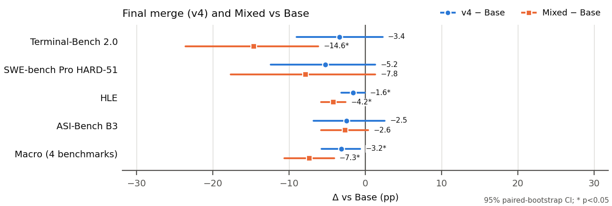
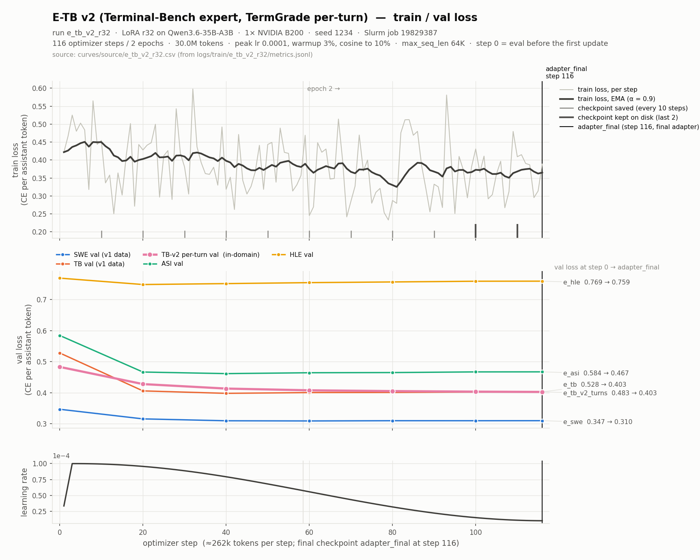
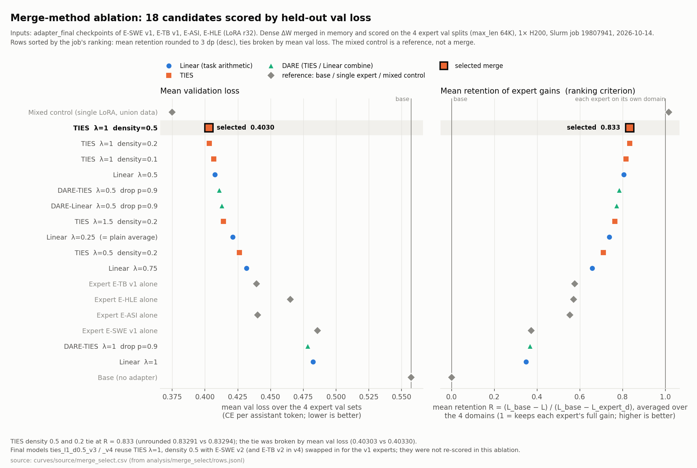

# Qwen3.6-35B-A3B 多专家 LoRA 训练与模型合版

> 状态：已完成（2026-10-16）。所有结果表格都由 `analysis/make_tables.py` 从逐任务结果（`results/**/*.jsonl`）重新生成，`analysis/readme_results.py` 把它们复制进 §8。
>
> 代码仓库：<https://github.com/eh3323/qwen36-moe-merge> · 一页报告：[`report.pdf`](report.pdf)（源文件 [`report.md`](report.md)） · 失败案例：[`analysis/failure_cases.md`](analysis/failure_cases.md)

## 术语与模型版本

| 名称 | 含义 |
|---|---|
| **Base** | 原始发布权重 Qwen3.6-35B-A3B @995ad96e，未做任何微调 |
| **专家**（E-xxx） | 针对单个 benchmark 训练的 LoRA adapter，挂在 Base 上使用 |
| E-SWE / E-TB / E-ASI / E-HLE | 分别针对 SWE-bench Pro / Terminal-Bench 2.0 / ASI-Bench / HLE |
| 专家的 **v1 / v2** | 同一专家的训练数据版本：v1 测试表现差，换数据重训得到 v2 |
| **合版**（merge） | 把多个专家的权重增量 ΔW 合成一个模型；本项目用 TIES |
| **Merged v3 / v4** | 合版模型的编号，组成见下表；**v4 是最终提交的模型** |
| **Mixed** | 对照组：把各专家的训练数据合在一起训练的单个 LoRA，不经过合版 |
| **折叠**（folded） | 把单个 LoRA 加回基座得到的完整权重（`src/merge/merge_lora_to_full.py`，fp32 计算 W + (α/r)·B·A 后存 bf16，数学上等价于 PEFT 的 `merge_and_unload()`），只涉及一个 adapter |

**合版的各个版本**。v3、v4 的编号延续了合版配置的迭代次序（前两次只有配置名），与专家的 v1 / v2 无关。

| 合版 | 包含的专家 | 状态 |
|---|---|---|
| 第 1 次：`ties_l1_d0.5` | E-SWE v1 + E-TB v1 + E-ASI + E-HLE | 只用于在留出验证集上选超参，没有生成模型 |
| 第 2 次：`ties_l1_d0.5_sweV2` | E-SWE **v2** + E-TB v1 + E-ASI + E-HLE | 预注册；E-TB v1 被剔除后放弃，未评测 |
| **Merged v3** | E-SWE v2 + E-ASI + E-HLE（去掉 E-TB） | 消融，只评 HLE |
| **Merged v4（最终）** | E-SWE v2 + E-TB **v2** + E-ASI + E-HLE | 四项全部评测 |

**融合程度**（所有版本相同，`configs/merge/ties.yaml`）：
- 每个专家、每个模块只保留幅值最大的 50% 元素（density 0.5），其余置零；
- 同一位置按符号投票，只对与多数同号的专家取平均（不是相加），各专家权重相同；
- 缩放 λ=1，即合并后的增量原样加回基座；
- 只合并 LoRA 覆盖的 250 个共享模块（注意力、Gated DeltaNet、shared expert）。256 个 routed experts 和 router 与 Base 完全相同；
- 在留出验证集上，第 1 次合版平均保留了单个专家 val loss 降幅的 83%（§3）。v4 在测试集上的表现见 §8。

## 题目要求对照

| 要求 | 位置 | 状态 |
|---|---|---|
| 基座 Qwen3.6-35B-A3B，固定 revision、tokenizer、依赖 | §5、`env/` | 满足 |
| 专家数量、划分逻辑与训练方式 | §1、§2 | 满足 |
| 自建训练数据：来源、许可、清洗、去重、去污染 | §7、`data/README.md` | 满足；去重只覆盖 SWE、HLE |
| 测试反馈不得用于训练或选择 | §0、§4 | **部分**：v2 专家的迭代和数据设计用到了测试反馈 |
| 用独立开发集调参 | §3 | **部分**：合版超参用的是训练数据的留出验证集 |
| 全部专家训练 + 可解释的对照（Mixed） | §2 | 满足 |
| 合版：原理、至少两种方法比较、冲突处理 | §3 | 满足 |
| Base 与 v4 四项全量评测，专家评目标 benchmark | §2.3、§8 | 满足 |
| TB2 五次运行、相同种子 | §11 第 2、21 条 | **未满足**：Base 4 次、v4 2 次 |
| 逐任务结果、运行失败率、成本、bootstrap CI | §8、`results/` | 满足；SWE 缺逐题 token，HLE 缺逐题耗时 |
| 模型卡设置与本实验设置的差异 | §6 | 满足 |
| 至少 20 个失败案例并按类别归因，至少 3 个下一步实验 | §10、§12 | 满足（46 个案例，5 个下一步实验） |
| 训练记录：配置、命令、种子、GPU、显存、时长、吞吐、学习率、checkpoint | §2.2、`logs/train/` | 满足 |
| loss 曲线、合版方法对比图、源数据与脚本 | `curves/` | 满足 |
| 训练、评测、错误超时、资源日志 | §16、`logs/` | 满足；含题目答案的原始输出留在集群 |
| HF 公开 checkpoint、revision、加载方法、许可证 | §13、`models/README.md` | 满足 |
| report.pdf 一页，摘要 150–200 字 | `report.pdf` | 满足 |
| 主动工作时长、GPU 小时、费用 | §14 | 满足 |

## 0. 速览

**主结果**：最终合版模型 v4 与本次实测 Base 的对比。宏平均 = 四项百分制主指标等权平均；Δ 的单位是百分点，95% CI 用同一批任务的配对 bootstrap 计算（§9）。

| Benchmark | 主指标 | Base | v4 | Δ（v4 − Base） | 95% CI |
|---|---|---|---|---|---|
| SWE-bench Pro HARD-51 | resolved % | 21.57 ± 5.19（3 次） | 16.34 ± 4.93（3 次） | −5.23 | [−12.42, +1.31] |
| Terminal-Bench 2.0 | 成功率 % | 44.94 ± 3.18（2 次） | 41.57（1 次） | −3.37 | [−8.99, +2.25] |
| HLE（2500 题）¹ | 准确率 % | 20.80 | 19.21 | −1.60 | [−3.16, −0.08] |
| ASI-Bench B3 | 得分（0–100） | 10.03 | 7.53 | −2.50 | [−6.79, +2.52] |
| **宏平均** | | **24.33** | **21.16** | **−3.18** | **[−5.75, −0.67]** |

- ¹ v4 有 1 题已生成但没有判分，不进分母（480/2499）；按 2500 计为 19.20，结论不变（§9）。
- TB2 一行只用 Nebius VM 上同条件的运行。把集群上的运行也算进来：Base 43.26 ± 2.83（4 次），v4 39.89 ± 2.38（2 次），Δ −3.37 [−8.99, +1.97]（§8.4）。
- 对照：v4 相对 Mixed 宏平均 +4.16 [+1.12, +7.28]，p=0.006；Mixed 相对 Base −7.32 [−10.65, −4.10]（§8.2）。
- **目标**：宏平均 +3pp，+5pp 为优秀参考。这是题目给出的挑战目标，不是已验证能够达到的门槛。结论：**未达到**。v4 相对 Base 的宏平均为 −3.18（p=0.012），四项都低于 Base，其中 HLE 显著；单项退步照实列出（§8、§10）。
- **最终模型**：v4 = E-SWE v2、E-TB v2、E-ASI、E-HLE 四个 LoRA 专家的 TIES 合版（`configs/merge/ties_v4.yaml`）。v4 在 2026-10-15 01:45 EDT 定稿，当时 v3 和 v4 都**还没有任何测试分数**。之前的迭代中有几步看过测试结果（§4）。
- **偏离题目规则：用到了测试反馈**。题目要求测试反馈不得用于训练或选择。以下几步用到了测试结果：剔除 E-TB v1；重训两个 v2 专家；v2 专家的数据设计。E-SWE v2 的语言配比参照 HARD-51（Go 40% / TS+JS 30% / Python 30%），过滤临时文件和改测试的规则来自 E-SWE v1 在 HARD-51 上的失败分析；E-TB v2 只保留通过 verifier 的轨迹，动机来自 E-TB v1 在 TB2 上的失败分析。影响方向：v4 和两个 v2 专家在 SWE、TB2 上的 Δ 可能偏乐观（§4）。合版超参和“v4 定为最终模型”这两步没有用到任何测试分数。
- **已确立的发现**：
  1. E-TB v1 在 TB2 上显著差于 Base（不一致对 17:2，McNemar p≈0.0007），已从合版中剔除。
  2. E-SWE v1 学到了教师的 OpenHands 风格，但没有学会根据测试结果修正。
  3. Terminus-2 存在一个上下文溢出后的摘要死循环，这是 harness 层面的失败模式。
  4. Base 在 HLE 上严重过度自信：平均自报置信度 97.3%，准确率 20.8%。



**实验概要**：
- **基座**：[Qwen/Qwen3.6-35B-A3B](https://huggingface.co/Qwen/Qwen3.6-35B-A3B) @ `995ad96eacd98c81ed38be0c5b274b04031597b0`。MoE，总参数约 35B，每个 token 激活约 3B，Apache-2.0。没有降到 7B，理由见 §5。
- **专家**：每个 benchmark 一个 LoRA 专家（r=32，每个约 1500 万训练 token）。合版用 E-SWE v2 / E-TB v2 / E-ASI / E-HLE；E-SWE v1、E-TB v1 是历史版本。
- **合版**：在稠密 ΔW 空间合并，最终用 TIES。超参从 18 个候选（Base、4 个单专家、Mixed，以及 12 个 Linear / TIES / DARE 合版）中按留出验证集的 val loss 选出（各专家训练数据中留出的 2%，不含 benchmark 数据，§3）。
- **对照**：Mixed，用专家训练数据的并集、相同超参训练的单个 LoRA（数据版本见 §2.1）。
- **评测**：SWE-bench Pro HARD-51、Terminal-Bench 2.0（Harbor + Terminus-2）、HLE（2500 题，完整多模态）、ASI-Bench seed31415 B3。
- **硬件**：NYU Torch 集群的 H200 141GB（E-TB v2 训练用 B200，部分评测用 RTX PRO 6000 96GB）；另租 RunPod 2×H200（ASI）和 Nebius 8×H100（TB2）。
- **模型权重**：LoRA 专家 [eh3323/Qwen3.6-35B-A3B-apex-lora-experts](https://huggingface.co/eh3323/Qwen3.6-35B-A3B-apex-lora-experts)，最终合版 [eh3323/Qwen3.6-35B-A3B-apex-merged-v4](https://huggingface.co/eh3323/Qwen3.6-35B-A3B-apex-merged-v4)。revision、merge recipe 和加载方法见 §13 与 [`models/README.md`](models/README.md)。

## 1. 研究问题

1. **专家划分**：按 benchmark 划分 4 个 LoRA 专家，每个只用约 1500 万 token 的目标域数据。它们能否在各自的 benchmark 上相对 Base 取得提升？
2. **合版**：4 个专家合成一个模型后，能保住多少专家增益？参数冲突（符号冲突、方向不一致）怎样处理？不同合版方法（Linear / TIES / DARE）表现有什么差别？
3. **合版的价值**：训练 token 数和超参相同时，“分别训专家再合版”和“直接用数据并集训一个模型”哪个更好？
4. **专家 SFT 学到了什么**：在 agent 任务上，小规模 SFT 学到的是能力还是教师的行为风格？这个问题通过逐任务失败分析回答（§10）。

## 2. 实验矩阵

### 2.1 模型

| 模型 | 训练数据 | 条数 / token | 进入 v4 | 备注 |
|---|---|---|---|---|
| Base | — | — | — | Qwen3.6-35B-A3B @995ad96e |
| E-SWE v1（历史） | SWE-rebench-OpenHands + SWE-Hero（只有 Python） | 432 / 15.05M | 否 | 只跑了 SWE r1 |
| **E-SWE v2** | Open-SWE-Traces 的 mini-swe-agent 轨迹（Go / TS / JS / Python） | 383 / 14.97M | **是** | 配方同 v1，只换数据 |
| E-TB v1（历史） | Nemotron-Terminal-Corpus + OpenThoughts-Agent | 973 / 15.02M | 否 | TB2 上显著退步，已剔除 |
| **E-TB v2** | TermGrade 中 verifier 判定通过的 Terminus-2 轨迹 | 1,215 / 15.02M | **是** | 按轮展开，修正 thinking 格式 |
| **E-ASI** | Nemotron-Terminal 科学计算子集 + jupyter-agent | 868 / 14.93M | **是** | |
| **E-HLE** | Nemotron-Math-v2 AoPS、Nemotron-Science、OpenScienceReasoning-2 | 1,838 / 15.1M | **是** | 纯文本 QA，HLE 答案格式 |
| Mixed（对照） | E-SWE v1、E-TB v1、E-ASI、E-HLE 四份数据的并集 | 约 60M | — | 用的是 v1 数据，见下 |

- 数据来源、许可证和教师模型见 §7 与 `data/README.md`（E-SWE v2 见 §9，E-TB v2 见 §10）。
- **Mixed 用 v1 数据**：Mixed 训练时 v2 数据还不存在，所以 SWE 和 TB 部分用的是 v1 数据（`configs/train/mixed.yaml`）。因此 v4 与 Mixed 的比较只在 ASI 和 HLE 上是同数据对照，SWE 和 TB 上还混有数据版本的差异（§11 第 9 条）。
- 合版模型（v3、v4 和两个未评测的合版配置）的组成见开头的“术语与模型版本”。配置分别是 `configs/merge/ties_v3.yaml`、`ties_v4.yaml`（模型名 `ties_l1_d0.5_v4`）和 `ties_swe_v2.yaml`。

### 2.2 训练配置

所有专家和 Mixed 的超参相同（`configs/train/base.yaml`）：

- **方法**：LoRA，不量化，bf16。r=32，α=64，dropout 0.05。
- **优化**：峰值学习率 1e-4，前 3% 的步数线性 warmup（3–14 步），之后 cosine 衰减到 1e-5；AdamW（β=0.9/0.999，weight decay 0），梯度裁剪 1.0。
- **批次与时长**：每个优化步 262,144 token，2 个 epoch，种子 1234。
- **上下文**：32K packing。E-SWE v1/v2、E-TB v2 和 Mixed 用 64K packing，每步的 token 数不变。
- **checkpoint**：每 10 步保存一次，只保留最近 2 个。最终 adapter 固定取最后一步（`adapter_final`），不按任何 benchmark 挑 checkpoint。第 0 步和之后每 20 步在留出验证集上算一次 val loss（每次运行有哪些验证集见下表的说明）。
- **硬件**：单卡训练，每次 1 个节点、1 张 GPU。6 次在 H200 上，E-TB v2 在 B200 上。没有一次被抢占或重启。

LoRA 目标模块共 250 个，约 3830 万参数：
- 10 个全注意力层的 `q/k/v/o_proj`；
- 30 个 Gated DeltaNet 层的 `in_proj_qkv/in_proj_z/out_proj`；
- 40 层的 `shared_expert.{gate,up,down}_proj`。

**不训练**的部分：256 个 routed experts、router、视觉塔、MTP 头。这样 adapter 更小，合版冲突只出现在共享模块上，便于分析；同时也避免少量数据扰动专家路由。

**为什么用 LoRA，而不是全参或 QLoRA：**
- **全参**：35B 参数用 AdamW 全参训练，仅 bf16 权重和梯度（各约 70GB）加上 fp32 主权重和两个动量（约 420GB）就超过 550GB，每个专家至少要 4–8 张卡做 ZeRO-3/FSDP。7 次训练的 GPU 小时会翻好几倍，而集群上组配额已满，多卡作业排队很久。每个专家只有约 1500 万 token，对 35B 参数做全参更新，过拟合和遗忘的风险也更大。
- **LoRA**：单卡就能训，峰值显存 83–96 GiB，每个专家 1.05–1.51 GPU 小时（§2.2 表）。adapter 只有 153MB，ΔW 是低秩的，正好作为合版用的 task vector（TIES/DARE 在稠密 ΔW 上操作，§3）。
- **QLoRA**：没有必要。bf16 基座单张 H200（141GB）就放得下。4-bit 量化后，LoRA 学到的是相对量化基座的修正，而合版和推理用的是 bf16 基座，两者不一致。反量化还会拖慢训练。

**训练记录**：每次训练的完整记录在 `logs/train/<run_id>/`，由集群上的运行日志（`$APEX/runs/<run_id>/logs/`）和 sacct 记录整理而来：
- `config.yaml`：解析继承链之后的完整配置快照；
- `launch_command.txt`：提交命令、Slurm SubmitLine，以及作业内实际执行的命令；
- `metadata.json`、`summary.json`：种子、GPU 型号与节点、显存、时长、吞吐、学习率调度、checkpoint 策略、软件版本；
- `metrics.jsonl`（逐步的 loss、学习率、tok/s、显存和 val loss）、`throughput.json`；
- Slurm 日志 `lora-<expert>-<job>.out`、`gpuutil-<job>.csv`（nvidia-smi 采样）、`checkpoints/*.state.json`（保存过的 checkpoint 的步数和累计 token）、`adapter_config.json`、`lora_targets.txt`。



上图以 E-TB v2 为例（train loss、各验证集 val loss 和学习率，标出 checkpoint），其余运行见 `curves/<run_id>.png`。下面两张表由 `logs/train/summary.csv` 整理（每次运行一行，列比下表全）；loss 曲线见 `curves/<run_id>.png`。

公共设置：1 张 GPU，种子 1234，LoRA r=32 / α=64 / dropout 0.05，峰值 lr 1e-4（3% warmup 后 cosine 到 1e-5），2 个 epoch，每 10 步存一次 checkpoint、只保留最近 2 个，最终取 `adapter_final`。adapter 都是 250 个模块、38,338,560 个参数，文件约 153 MB。

**资源与时长**

| 模型 | run_id | GPU · 节点 | Slurm job | 序列长度 | 墙钟（min） | GPU 小时 | 步数（warmup） | 训练 token | 吞吐（tok/s） | 峰值显存（GiB） |
|---|---|---|---|---|---|---|---|---|---|---|
| E-SWE v1 | `e_swe_r32` | H200 · gh105 | 19741877 | 64K | 85.7 | 1.43 | 124（4） | 30.11M | 7,923 | 96.3 |
| E-SWE v2 | `e_swe_v2_r32` | H200 · gh101 | 19816112 | 64K | 90.6 | 1.51 | 130（4） | 29.93M | 7,533 | 96.3 |
| E-TB v1 | `e_tb_r32` | H200 · gh105 | 19742097 | 32K | 75.2 | 1.25 | 116（3） | 30.05M | 8,482 | 82.8 |
| E-TB v2 | `e_tb_v2_r32` | B200 · gb004 | 19829387 | 64K | 63.0 | 1.05 | 116（3） | 30.05M | 10,147 | 96.3 |
| E-ASI | `e_asi_r32` | H200 · gh105 | 19742098 | 32K | 76.1 | 1.27 | 125（4） | 29.86M | 8,407 | 82.8 |
| E-HLE | `e_hle_r32` | H200 · gh115 | 19752117 | 32K | 76.0 | 1.27 | 118（4） | 30.25M | 8,239 | 82.9 |
| Mixed | `mixed_r32` | H200 · gh116 | 19752119 | 64K | 273.0 | 4.55 | 462（14） | 120.26M | 8,358 | 96.3 |
| **合计** | | | | | **739.5** | **12.32** | | | | |

**loss**（train loss 为最后 10 步的均值；val loss 为域内验证集上第 0 步与最终的值）

| 模型 | train loss | 验证集 | val loss 第 0 步 | val loss 最终 |
|---|---|---|---|---|
| E-SWE v1 | 0.1876 | `e_swe` | 0.3468 | 0.1796 |
| E-SWE v2 | 0.5365 | `e_swe_v2` | 0.6806 | 0.5103 |
| E-TB v1 | 0.3495 | `e_tb` | 0.5280 | 0.3128 |
| E-TB v2 | 0.3657 | `e_tb_v2_turns` | 0.4831 | 0.4027 |
| E-ASI | 0.3201 | `e_asi` | 0.5849 | 0.3397 |
| E-HLE | 0.7061 | `e_hle` | 0.7691 | 0.6816 |
| Mixed | 0.4811 | `e_swe` | 0.3468 | 0.1813 |
| Mixed | | `e_tb` | 0.5281 | 0.3056 |
| Mixed | | `e_asi` | 0.5851 | 0.3315 |
| Mixed | | `e_hle` | 0.7691 | 0.6811 |

- **口径**：墙钟 = Slurm 作业时长（sacct Elapsed，含模型加载、val 和保存）；GPU 小时来自 `logs/resources/gpu_hours.csv`（sbatch 脚本内计时，与墙钟差几秒）。训练 token 是 2 个 epoch 的总数，每个 epoch 约 15M（Mixed 约 60M）。吞吐是第 4 步之后各步 tok/s 的中位数。峰值显存是 PyTorch 的 max allocated（reserved 和 nvidia-smi 峰值见 `summary.csv`）。
- **验证集**：E-SWE v1、E-TB v1、E-ASI 训练时 HLE 验证集还没建好，这三次只有 SWE / TB / ASI 三个验证集，没有 HLE val loss。E-HLE 和 Mixed 有 4 个；两个 v2 专家另有自己的第 5 个验证集（`e_swe_v2`、`e_tb_v2_turns`）。
- **可比性**：val loss 只能在 max_seq_len 相同的运行之间比较。截断长度不同，同一模型的 loss 也不同：Base 在 SWE 验证集上第 0 步的 loss 在 32K 下是 0.3547，在 64K 下是 0.3468。不同验证集之间的数值也不能直接比较。
- **E-SWE v2** 只在自己的验证集上下降，在其他验证集上没有下降（v1 SWE 0.3468 → 0.4223，TB 0.5281 → 0.5252，ASI 0.5851 → 0.6007，HLE 0.7691 → 0.7816）。各运行在全部验证集上的最终值见 `summary.csv` 的 `val_final_*` 列。
- 吞吐测试（`logs/train/_throughput/`，作业 19741081）不在表内。

LoRA 折叠进基座后的完整权重约 67GB（bf16），合版模型也是这个大小。

### 2.3 评测覆盖

“—”表示按计划不评（算力不足）。“云上”指 Nebius 8×H100 VM 上的 Docker 运行（§11 第 21 条）；ASI 全部在 RunPod 上跑（§11 第 19 条）。

| 模型 | SWE HARD-51 | TB2 | HLE | ASI B3 |
|---|---|---|---|---|
| Base | 3 次（r1–r3） | 4 次（集群 a1–a2，云上 a1–a2） | 1 次 | 1 次 |
| **Merged v4** | 3 次 | 2 次（集群 a1，云上 a1） | 1 次 | 1 次 |
| E-SWE v2 | 1 次 | — | — | — |
| E-TB v2 | — | 1 次（云上） | — | — |
| E-ASI | — | — | — | 1 次 |
| E-HLE | — | — | 1 次 | — |
| Mixed | 1 次 | 1 次（云上） | 1 次 | 1 次 |
| E-SWE v1（历史） | 1 次（r1，41 道有效题） | — | — | — |
| E-TB v1（历史） | — | 1 次（a1；a2 跑到 60/89 时取消） | — | — |
| Merged v3（消融） | — | — | 1 次 | — |

完成状态：除 TB2 的运行次数外，表中所有单元格都已完成。TB2 题目要求 5 次，实际 Base 4 次、v4 2 次（§11 第 2、21 条）；集群上的 v4 a2 截止时未跑完，不计入。

## 3. 合版方法

**表示**：对每个被适配的模块，专家 t 的任务向量为稠密矩阵 τ_t = (α/r)·B_t·A_t（fp32）。合并后的 τ 直接折叠进基座：W' = W + τ，fp32 相加后转回 bf16，逐 shard 写出。实现见 `src/merge/merge_experts.py`。

**方法**：

| 方法 | 稀疏化 | 合并 |
|---|---|---|
| Linear（任务算术） | 无 | τ = λ Σ w_t τ_t（λ=1/K 即简单平均） |
| TIES | 每个专家每个模块保留幅值前 density 的元素 | 符号投票后只对同号专家加权平均，再乘 λ |
| DARE-Linear / DARE-TIES | 以概率 p 随机丢弃，幸存元素放大 1/(1−p) | 同 Linear / TIES |

**参数冲突的处理（TIES）**：
1. 幅值裁剪去掉各专家的小幅值噪声；
2. 同一位置符号不一致时按加权和投票，与多数方向相反的值直接丢弃；
3. 对同号的专家取平均而不是求和，所以几个专家方向一致的位置不会被放大 K 倍。

相比之下，Linear 在 λ=1 时把各专家的幅值直接相加；平均（λ=1/K）又会把每个专家的贡献稀释到 1/K。冲突分析（逐模块的 cos(τ_i, τ_j)、top-k 重叠位置上的符号冲突率）由 `configs/merge/analysis.yaml` 生成，在 v1 那组专家（E-SWE v1、E-TB v1、E-ASI、E-HLE）上做，结果在 `analysis/merge_conflicts_v1/`（`summary.json`、`pairwise.csv`、`per_module.csv` 和三张热力图）。摘要：250 个模块平均下来，大多数专家对的 task vector 几乎正交（cos 0.016–0.064），在两者 top-k 都选中的位置上符号冲突率为 0.42–0.48，接近随机的 0.5。例外是 E-TB v1 与 E-ASI：cos 0.38，重叠位置符号冲突率只有 0.12，两者都是多轮 agent 轨迹数据，更新方向高度一致。也就是说，TIES 的符号投票主要在近乎独立的方向之间做取舍，冲突本身不是主要矛盾；更大的问题是每个专家的 Δ 在合版时被稀释（§3 的保留率）。

**选择协议**：`src/merge/merge_select.py` + `configs/merge/select.yaml`。
- **候选**：共 18 个。包括 Base、4 个专家单独、Mixed；Linear λ∈{0.25, 0.5, 0.75, 1.0}；TIES (density, λ)∈{(0.2, 0.5), (0.2, 1.0), (0.2, 1.5), (0.1, 1.0), (0.5, 1.0)}；DARE-TIES p=0.9、λ∈{0.5, 1.0}；DARE-Linear p=0.9、λ=0.5。
- **数据**：4 个专家的**留出验证集**：从各自训练数据源中按 instance_id 分组留出 2%（`configs/train/base.yaml` 的 `data.val`），与训练集不重叠，不含任何 benchmark 数据。§7 列出的独立开发集（TBLite、GPQA 等）建好了，但没有用于这次选择。
- **打分**：在内存里逐个候选计算 val loss（所有候选用同一组验证集、同一 max_seq_len 64K），并计算保留率 R_d = (L_d(base) − L_d(cand)) / (L_d(base) − L_d(expert_d))。按 4 个域的平均保留率排序：平均保留率先四舍五入到 3 位小数，相同时再按平均 val loss 升序。
- **适用范围**：这次选择用的是 v1 专家组合（E-SWE v1、E-TB v1、E-ASI、E-HLE）。v3/v4 沿用同一组超参，没有重新打分（§11 第 16 条）。

**结果**（`analysis/merge_select/{table.md,table.csv,rows.jsonl}`，图 `curves/merge_ablation.png`）：



- **选中 `ties_l1_d0.5`**（TIES，density 0.5，λ=1）：平均 val loss 0.4030，平均保留率 0.833。
- **它与 `ties_l1_d0.2` 实际上打平**。未取整的平均保留率：`ties_l1_d0.2` 为 0.83294，`ties_l1_d0.5` 为 0.83291。两者取 3 位小数后都是 0.833，于是按平均 val loss（0.4030 vs 0.4033）判给了 density 0.5。如果按未取整的保留率排序，选中的会是 density 0.2。
- **参照点**：Base 的平均 val loss 为 0.5573；4 个单专家为 0.439–0.486。E-TB v1 和 E-ASI 在对方的验证集上也明显下降（两者都用了 Nemotron-Terminal 数据）。
- **发现：Mixed 对照在 val loss 上胜过所有合版候选**。Mixed 的平均 val loss 为 0.3750，平均保留率 1.015；在 TB、ASI、HLE 三个验证集上甚至低于对应的单专家（保留率 > 1），SWE 上为 0.988。最好的合版只保住了约 83% 的专家增益。注意 Mixed 的训练 token 等于 4 个专家之和（462 步，单个专家约 120 步）。这只是 val loss 的比较，benchmark 上的对比见 §8。
- 直接相加 4 个任务向量（`linear_l1`）或 DARE-TIES λ=1 时，平均保留率只有 0.35–0.37，HLE 验证集的 loss 比 Base 还高。

| 候选 | 平均 val loss | 平均保留率 | SWE val loss | TB val loss | ASI val loss | HLE val loss |
|---|---|---|---|---|---|---|
| `adapter:mixed`（Mixed 对照） | 0.3750 | 1.015 | 0.1817 | 0.3057 | 0.3316 | 0.6811 |
| **`ties_l1_d0.5`（选中）** | **0.4030** | **0.833** | 0.2143 | 0.3303 | 0.3596 | 0.7079 |
| `ties_l1_d0.2` | 0.4033 | 0.833 | 0.2136 | 0.3314 | 0.3609 | 0.7074 |
| `ties_l1_d0.1` | 0.4067 | 0.815 | 0.2214 | 0.3326 | 0.3656 | 0.7074 |
| `linear_l0.5` | 0.4076 | 0.806 | 0.2243 | 0.3332 | 0.3634 | 0.7096 |
| `dare_ties_l0.5_p0.9` | 0.4110 | 0.785 | 0.2289 | 0.3353 | 0.3679 | 0.7120 |
| `dare_linear_l0.5_p0.9` | 0.4130 | 0.772 | 0.2294 | 0.3385 | 0.3697 | 0.7145 |
| `ties_l1.5_d0.2` | 0.4140 | 0.763 | 0.2126 | 0.3502 | 0.3727 | 0.7203 |
| `linear_l0.25`（简单平均） | 0.4212 | 0.738 | 0.2499 | 0.3425 | 0.3831 | 0.7092 |
| `ties_l0.5_d0.2` | 0.4263 | 0.711 | 0.2482 | 0.3529 | 0.3918 | 0.7123 |
| `linear_l0.75` | 0.4316 | 0.657 | 0.2303 | 0.3691 | 0.3942 | 0.7329 |
| `expert:e_tb`（E-TB v1） | 0.4394 | 0.577 | 0.3172 | 0.3129 | 0.3863 | 0.7411 |
| `expert:e_hle` | 0.4651 | 0.570 | 0.3136 | 0.4048 | 0.4605 | 0.6817 |
| `expert:e_asi` | 0.4400 | 0.554 | 0.3213 | 0.3510 | 0.3397 | 0.7480 |
| `expert:e_swe`（E-SWE v1） | 0.4857 | 0.373 | 0.1798 | 0.4613 | 0.5284 | 0.7734 |
| `dare_ties_l1_p0.9` | 0.4784 | 0.367 | 0.2617 | 0.4271 | 0.4504 | 0.7744 |
| `linear_l1`（直接相加） | 0.4823 | 0.349 | 0.2554 | 0.4378 | 0.4599 | 0.7763 |
| `base` | 0.5573 | 0.000 | 0.3468 | 0.5281 | 0.5851 | 0.7691 |

候选命名：`linear_lX` = Linear，λ=X；`ties_lX_dY` = TIES，λ=X、density=Y；`dare_*_pZ` = DARE，丢弃率 Z。表按选择协议的排序列出。

benchmark 上的合版消融只做了 v3 与 v4 在 HLE 上的对比（v4 = v3 再加入 E-TB v2）：v3 17.36%，v4 19.21%，v4 − v3 = +1.88 [+0.36, +3.44]（n=2499），McNemar v4 独对 214 : v3 独对 167，p=0.018（§8.3）。

## 4. 决策记录与 test-informed 选择

完整时间线见 `logs/worklog.md`。下表列出所有影响最终模型的决定，以及当时是否看过测试集结果。

| 时间（EDT） | 决策 | 依据 | 用到测试结果 |
|---|---|---|---|
| 10-13 14:50 | 4 个专家 + 合版，混训单模型作对照 | 算力与时间预算 | 否 |
| 10-14 ~11:50 | 合版超参定为 TIES、λ=1、density 0.5 | 留出验证集 val loss 保留率（§3）¹ | 否 |
| 10-14 ~13:10 | 用新数据训练 E-SWE v2，替换 E-SWE v1 | E-SWE v1 在 SWE r1 没有超过 Base² | **是** |
| 10-14 ~18:00 | 合版去掉 E-TB v1，改为 v3 | E-TB v1 在 TB2 上显著差于 Base³ | **是** |
| 10-14 ~18:15 | 新增 v4 = v3 + E-TB v2⁴ | E-TB v2 修正了 thinking 格式 | 否（重训动机来自 E-TB v1 的测试） |
| 10-15 01:45 | **最终模型定为 v4**，v3 只评 HLE | H200 排队太长，来不及比较 v3 / v4⁵ | **否**：v3 / v4 都还没有分数 |

- ¹ 选择作业 19807941。当时的专家组合是 E-SWE v1 / E-TB v1；与 `ties_l1_d0.2` 实际打平，按平均 val loss 决出。
- ² 不一致对 5:1，不显著，轨迹分析见 §10。新配置为 `ties_swe_v2.yaml`。
- ³ TB2 a1，不一致对 17:2，McNemar p≈0.0007。预注册的 `ties_l1_d0.5_sweV2` 因此不再评测。
- ⁴ v4 的评测作业在 E-TB v2 训练前就已提交，依赖训练完成。E-TB v2 于 21:08 训完，在所有验证集上 val loss 都下降，21:10 构建 v4。
- ⁵ 按原计划比较 v3 / v4 会把最终结果拖到 16 号以后。同时取消 v3 的 TB2 / SWE / ASI 评测和 E-SWE v1 的 SWE 重复运行。决定时 HLE 只完成了生成，还没有判分。

**说明**：
- `configs/merge/ties_v4.yaml` 的注释里写着原计划“按四项宏平均在 v3/v4 之间择优”。那样做属于 test-informed 选择。这个计划已被 10-15 01:45 的决定取代，没有执行。
- **数据设计也用到了测试信息**：E-SWE v2 的语言配比照 HARD-51 设定（`src/data/build_swe_v2.py` 的 `LANG_FRAC`），过滤临时文件和测试改动的规则（`_SCRATCH`、`_TESTY`）来自 E-SWE v1 在 HARD-51 轨迹上的失败分析；E-TB v2 只保留 reward==1 的轨迹（`src/data/build_tb_v2.py`），动机来自 E-TB v1 在 TB2 上“没验证就宣称完成”的失败。这些没有用到测试题目、答案或测试代码本身，但属于按测试反馈调整训练数据。
- 剔除 E-TB v1、重训 E-SWE/E-TB 都是看过 SWE/TB2 测试结果之后的迭代。因此 v4 相对 Base 在 SWE 和 TB2 上的 Δ 可能有选择偏差，方向偏乐观。v4 的合版超参和“定为最终”这一步都没有用到 v3/v4 的测试分数。

## 5. 基座、硬件与时间预算

- 选择 35B-A3B，没有降到 7B。原因：
  - 每个 token 只激活约 3B 参数，推理速度和 3B 左右的稠密模型相当；
  - bf16 权重 67GB，单张 H200 就放得下；
  - 吞吐测试（`logs/train/_throughput/`）中单张 H200 约 8.7k token/s（32K 序列，峰值显存 83GB；64K 序列 8.3k token/s，96GB）。正式训练实测 H200 上 7.5k–8.5k token/s、B200 上 10.1k token/s，一个专家 2 个 epoch 用 1.05–1.51 GPU 小时（§2.2）；
  - 评测的瓶颈在 agent 沙箱的实际执行时间，换成 7B 并不会显著变快。
- **硬件**：NYU Torch 集群（Slurm）。
  - 训练：每个作业单卡。6 次在 H200 上，E-TB v2 在 B200 上。32K 的作业提交时允许 H200 / B200 / RTX PRO 6000（`CONSTRAINT`），实际都分到了 H200。
  - 评测：每个分配 1–4 张 GPU，vLLM 和沙箱在同一节点上（`slurm/eval_allinone.sbatch`）。
  - 集群上没有 Docker，沙箱用 apptainer（§11）。
  - **GPU 利用率填充（只在集群上）**：集群会取消 2 小时内平均 GPU 利用率低于 60% 的 H200 作业，而 agent 评测时 vLLM 大部分时间在等沙箱执行命令。所以集群上的每个 vLLM 服务作业里同时运行 `scripts/gpu_keepalive_shared.py`（`slurm/serve_model.sbatch`）：vLLM 空闲时在同一张卡上跑矩阵乘法，把利用率维持在约 92%；vLLM 有负载时自动退让。它不改变 vLLM 的任何设置和输出，只可能在退让之前短暂拖慢请求，属于吞吐层面的影响。RunPod 和 Nebius 上没有运行它（RunPod 上脚本文件不存在，启动即失败，日志见 `logs/eval/runpod/`；`scripts/tb2_cloud.sh` 不调用它）。
- **时间预算**：2026-10-13 08:11 EDT 收到笔试邮件，72 小时内（10-16 08:11 EDT）提交。实际用时、GPU 小时和费用见 §14。
- **固定版本**：
  - 基座 revision；tokenizer 和 chat template 取基座目录里的 `chat_template.jinja`；
  - 训练环境：torch 2.12.1+cu129、transformers 5.19.0、peft 0.21.2、fla 0.5.2（uv 编译的锁定文件 `configs/train/train.lock.txt`）；
  - 推理环境：vLLM 0.30.0、torch 2.13.0+cu129、transformers 5.19.0（`configs/serve.lock.txt`）；
  - **依赖锁定文件**：集群上 7 个环境（train、serve、eval、hle、asi、data、dl）实际安装的包版本，用 `uv pip freeze` 导出到 `env/<env>.freeze.txt`（2026-10-15 只读导出，文件头注明 Python 版本和用途）；环境变量与缓存路径见 `env/env.sh`；
  - 每次训练的配置快照、启动命令、种子、GPU、显存、时长、吞吐、学习率和 checkpoint 策略见 `logs/train/<run_id>/` 与 `logs/train/summary.csv`（§2.2）。

## 6. Benchmark 版本、split 与评测设置

所有版本在训练前锁定（2026-10-13，`configs/eval/benchmarks.yaml`），harness 参数集中在 `configs/eval/harness.env`。

| Benchmark | 数据版本 | Split / 任务 | 主指标 | Agent / 评测器 |
|---|---|---|---|---|
| SWE-bench Pro v2-hard | `ScaleAI/SWE-bench_Pro` @2d52cb3d | HARD-51（51 题） | resolved rate | mini-swe-agent 2.4.6 |
| Terminal-Bench 2.0 | `laude-institute/terminal-bench-2` @2fd12b88 | 89 个任务 | 成功率 | Harbor @4778ceba + Terminus-2 |
| HLE | `cais/hle` @5a81a4c7 | test 全部 2500 题 | 准确率 + 校准误差 | 官方 `hle_eval` @22ed3074，不用工具 |
| ASI-Bench | `ASI-Bench-seed31415` @0fa1421 | B3 档，60 个实例 | B3 得分（0–100） | `opencode_cli`（opencode 1.17.15） |

**各 benchmark 的具体设置**：
- **SWE-bench Pro**
  - 数据另含 `scaleapi/SWE-bench_Pro-os` @66f92766（config `hard`）；任务清单 `v2/hard51_ids.txt` 和 agent 配置 `v2/tooling/configs/mini_toolcall.yaml`（含 prompt）的副本在 `configs/eval/swe/`。容器镜像用数据集给出的 tag，没有记录 digest。
  - 官方 patch_replay 判分。mini-swe-agent 用 `mini_toolcall.yaml`（单个 bash 工具），host 端驱动。
  - 每题最多 250 步、50 分钟（提前 60 s 软停，已有补丁照常判分）。
  - Agent 阶段沙箱断网（`--net --network none`），判分阶段按协议联网。容器内存上限 4GB（题目设置）。
- **Terminal-Bench 2.0**
  - 任务版本含 TB2.1 的任务修复。Base 和最终模型按题目要求取多次运行的均值 ± 标准差。
  - 3 小时超时，每个 trial 32 CPU / 48GB RAM（名义值，见 §11）。
  - T=1.0、top_p=0.95、top_k=20、max_tokens=80K（81920），256K 上下文；Terminus-2 的 `max_input_tokens` = 262144 − 81920 = 180224。
- **HLE**
  - 342 道图像题照常评测（完整多模态，不做 text-only）。无预测按错误计入。
  - 补丁 `patches/hle_eval_apex.patch` 只增加：采样参数、请求超时（7200 s）、增量 checkpoint、记录 finish_reason 和 reasoning（不送给判分模型），以及冒烟测试用的 `--ids` 子集。
  - T=1.0、top_p=0.95、top_k=20、presence_penalty=1.5，max_completion_tokens 81920。
  - 答案抽取和判分都用官方未修改的 `run_judge_results.py`，判分模型 o3-mini-2025-01-31。
- **ASI-Bench**
  - 代码 `apexin-ai/ASI-Bench` @8859f9b。得分为各实例 final_score / max_score 的均值。
  - `linux_ns` 沙箱：用户 / 挂载 / 网络命名空间隔离，只有 loopback，经 Unix socket 访问模型；超时 10800 s。实际评测在 RunPod 上进行，没有这层隔离（§11 第 19 条）。
  - 参考答案对 agent 隐藏，用 `asibench score --repo seed31415` 本地评分；13/60 个实例需要 LLM 判分，用官方设置的 GPT-5.5。这是**本地评分，不是官方分数**。

**所有模型在同一 benchmark 内的设置完全一致**：
- 服务：vLLM 0.30.0，bf16，TP=1（多卡时做数据并行），`max_model_len`=262144，`--seed 0`，prefix caching；reasoning parser `qwen3`，tool parser `qwen3_coder`。
- 模型差异：tokenizer、chat template 和 generation_config 一律取基座目录，各模型之间只有权重不同。
- thinking：`enable_thinking=true`、`preserve_thinking=false`。
- 生成上限：harness 不传 max_tokens 时，服务端默认 81920。
- 核对方式：每个请求实际发出的采样参数和 token 用量都由代理记录到 `llm_requests.jsonl`；每次运行的 harness 配置及其 sha256、所用的模型目录和 GPU 型号写入 `run_meta.json`。

TB2 的设置对齐模型卡。凡是模型卡没有给出的设置（SWE、HLE、ASI 的具体协议），均为**本实验设置**，不声称复现官方成绩。官方分数只作背景参考，不与本实验的数字直接相减。

**与模型卡设置的差异**（模型卡 @995ad96e）：

| 项目 | 模型卡 | 本实验 |
|---|---|---|
| SWE-bench Pro | 内部 agent 框架（bash + 文件编辑工具），200K 上下文，修正过的完整公开集 | mini-swe-agent，只有 bash 工具，256K 上下文，HARD-51 |
| Terminal-Bench 2.0 | Harbor / Terminus-2，设置同本实验，5 次平均 | 相同设置；同条件下 Base 2 次、v4 1 次 |
| HLE | 未写协议 | 官方 `hle_eval`，不用工具，含图像题 |
| ASI-Bench | 未报告 | seed31415 B3，本地评分 |
| 采样（thinking） | T=1.0、top_p=0.95、top_k=20、presence_penalty=1.5 | HLE 相同；TB2 同模型卡的 TB2 设置；SWE、ASI 见下 |
| preserve_thinking | 默认关闭，agent 示例中打开 | 关闭（所有模型一致） |

- agent harness（TB2、SWE、ASI）都不发 presence_penalty。SWE 和 ASI 的请求由 harness 发出，请求里没指定的采样参数取基座 generation_config 的默认值；每个请求实际发出的参数记录在原始输出的 `llm_requests.jsonl`。

**与模型卡分数的对照**（只作背景，不相减）：模型卡给出的 Qwen3.6-35B-A3B 分数是 HLE 21.4、Terminal-Bench 2.0 51.5、SWE-bench Pro 49.5。
- **HLE**：实测 Base 20.8（官方脚本给出的置信区间 ±1.59），与 21.4 一致，可以作为 HLE 流程正确的旁证。
- **TB2**：实测 Base 44.9（Nebius 2 次）/ 43.3（4 次合计），比 51.5 低约 7 个百分点。可能的原因包括：Terminus-2 上下文溢出后的摘要死循环（§10 的 T8；集群上 Base 每次有 11–12 个 trial 陷入这个循环）、本实验没有开 preserve_thinking、运行环境不同（Docker / apptainer 与内部环境）。这些原因没有逐项验证。
- **SWE**：任务集（HARD-51 vs 修正后的完整公开集）和 agent 框架都不同，不可比。

**ASI 的聚合方式**：主指标是 60 个实例 final_score / max_score 的均值，评分器出错的实例（env_error）按 0 分计入，与其他 benchmark 的处理一致（题目要求环境失败单列、不能剔除后提分）。官方 `asibench score` 把评分器出错的实例标为 NOT SCORED 并从分母中剔除，按这一口径的分数是 §8.5 的“剔除 env_error 后”一列：Base 10.20、E-ASI 8.02、Mixed 7.65、v4 7.66。

## 7. 训练数据（详见 `data/README.md`）

| 专家 | 数据集 | 许可证 | 教师模型 | 条数 / token | 格式 |
|---|---|---|---|---|---|
| E-SWE v1 | SWE-rebench-openhands-trajectories（只取 resolved）+ SWE-Hero | CC-BY-4.0 | Qwen3-Coder-480B | 432 / 15.05M | mini_toolcall |
| E-SWE v2 | Open-SWE-Traces @1db67417（mini-swe-agent 轨迹） | CC-BY-4.0 | Qwen3.8-27B thinking | 383 / 14.97M | mini_toolcall |
| E-TB v1 | Nemotron-Terminal-Corpus + OpenThoughts-Agent-SFT-100K | CC-BY-4.0 / Apache-2.0 | DeepSeek-V3.2 / GLM-4.7 | 973 / 15.02M | Terminus-2 JSON |
| E-TB v2 | termgrade-trajectories @7d584d63（只取 reward==1） | Apache-2.0 | 4 个开源模型¹ | 1,215 / 15.02M² | Terminus-2 JSON，按轮展开 |
| E-ASI | Nemotron-Terminal 科学计算子集 + jupyter-agent | CC-BY-4.0 / Apache-2.0 | DeepSeek-V3.2 / Qwen3-Coder | 868 / 14.93M | opencode bash 工具调用 |
| E-HLE | Nemotron-Math-v2 AoPS、Nemotron-Science-v1、OpenScienceReasoning-2 | CC-BY-4.0 | gpt-oss-120b / DeepSeek-R1 | 1,838 / 15.1M | HLE 官方答案格式 |

- 完整的数据集 id（含组织名）、revision 和许可证说明见 `data/README.md` §3。
- ¹ DeepSeek-V4-Pro、GLM-5.2、Qwen3.6-27B、Gemma-4-31B。
- ² 按轮展开后的条数，其中 label token 3.50M；格式与评测时的 prompt 逐字节一致。
- **按 token 对齐，不按条数对齐**：每个专家约 1500 万训练 token，让各专家的优化量相同。agent 轨迹长，所以条数少。
- **只用开源权重、宽松许可证的教师模型**。闭源 API 生成的轨迹、非商用许可证的数据、所有 HLE 衍生数据集都已排除。
- **去污染**：
  - SWE：剔除 11 个 SWE-Pro（HARD-51）仓库、整个 `ansible/*` 组织和疑似 fork，做 13-gram 查重；
  - TB：剔除与 TB2 重合的 90 个 TB1 任务及 TB2 任务名，做 13-gram 查重；
  - ASI：方法名黑名单、13-gram、embedding 相似度 ≥ 0.85；
  - HLE：canary、精确匹配、13-gram、embedding 相似度 ≥ 0.9。
- **benchmark 隔离**：四项评测的题目、答案、参考补丁、隐藏测试和测试反馈一律不用于训练，也不用于选 checkpoint。数据代码读任何路径都要经过 `common.guard_path()`，路径里出现 `seed31415` 就直接报错。合版超参只用各专家训练数据的留出验证集（2%，与训练集不重叠）选择。另外建了独立开发集（SWE-rebench-V2 留出的仓库、OpenThoughts-TBLite、ScienceAgentBench、GPQA-Diamond 和 HLE 风格的留出题），但时间不够，最终没有用它们评测或选择。注意：v2 专家的数据设计用到了测试结果的信息（§4）。
- **清单**：每条样本的 id、sha256、丢弃原因统计保存在 `data/manifests/`（`scripts/fetch_data_manifests.sh` 从集群拉回；只有 id、哈希和计数，不含样本文本）。

## 8. 结果

<!-- results:begin -->
<!-- 由 analysis/readme_results.py 从 analysis/results_tables.md（2026-10-16T06:51）复制，勿手改；完整版含失败率与 token 用量见该文件 -->

### 8.1 分数矩阵

主指标为百分制，env_error 按 0 分计入（§9）。多次运行时为均值 ± 标准差（ddof=1）及次数。TB2 只用 Nebius VM 上的运行（所有模型同一节点、同一设置，§11 第 21 条）；集群上的 TB2 运行见下方列表和 8.4。“—”表示不在该模型的评测范围内。

| Benchmark | Base | E-SWE v2 | E-TB v2 | E-ASI | E-HLE | Mixed | v4 |
|---|---|---|---|---|---|---|---|
| Terminal-Bench 2.0 | 44.94 ± 3.18 (n=2) | — | 38.20 (n=1) | — | — | 30.34 (n=1) | 41.57 (n=1) |
| SWE-bench Pro HARD-51 | 21.57 ± 5.19 (n=3) | 27.45 (n=1) | — | — | — | 13.73 (n=1) | 16.34 ± 4.93 (n=3) |
| HLE | 20.80 (n=1) | — | — | — | 16.92 (n=1) | 16.60 (n=1) | 19.21 (n=1) |
| ASI-Bench B3 | 10.03 (n=1) | — | — | 7.75 (n=1) | — | 7.39 (n=1) | 7.53 (n=1) |
| **宏平均（4 项）** | **24.33** | — | — | — | — | **17.02** | **21.16** |

- 不在矩阵中的运行：
  - E-SWE v1（历史）：SWE-Pro 9.80 (n=1)
  - E-TB v1（历史）：TB2 24.72 (n=1)
  - v3（历史）：HLE 17.36 (n=1)
  - Base（集群 TB2）：TB2 41.57 ± 1.59 (n=2)
  - v4（集群 TB2）：TB2 38.20 (n=1)
  - Base（全部 TB2 运行）：TB2 43.26 ± 2.83 (n=4)
  - v4（全部 TB2 运行）：TB2 39.89 ± 2.38 (n=2)
- HLE 校准误差（RMS，β=100，按官方 hle_eval 的方法复算，§9）：Base 73.9, E-HLE 35.9, v3（历史） 61.3, v4 64.3, Mixed 36.2.

### 8.2 相对 Base 的差值（95% CI）

配对 bootstrap（按任务配对，每个任务取该模型所有运行的平均分，10,000 次重采样，seed 0），p 为双侧 bootstrap p。宏平均为四项等权，在每个 benchmark 内分别重采样（§9）。

| Benchmark | v4 − Base | Mixed − Base | v4 − Mixed |
|---|---|---|---|
| Terminal-Bench 2.0 | −3.37 [−8.99, +2.25], p=0.263 (n=89) | −14.61 [−23.60, −6.18], p=0.0006 (n=89) | +11.24 [+3.37, +20.22], p=0.011 (n=89) |
| SWE-bench Pro HARD-51 | −5.23 [−12.42, +1.31], p=0.108 (n=51) | −7.84 [−17.65, +1.31], p=0.096 (n=51) | +2.61 [−5.23, +10.46], p=0.567 (n=51) |
| HLE | −1.60 [−3.16, −0.08], p=0.042 (n=2499) | −4.20 [−5.80, −2.60], p<0.0002 (n=2500) | +2.64 [+1.12, +4.16], p=0.001 (n=2499) |
| ASI-Bench B3 | −2.50 [−6.79, +2.52], p=0.292 (n=60) | −2.64 [−5.83, +0.39], p=0.088 (n=60) | +0.14 [−3.46, +4.67], p=0.990 (n=60) |
| **宏平均** | −3.18 [−5.75, −0.67], p=0.012 | −7.32 [−10.65, −4.10], p<0.0002 | +4.16 [+1.12, +7.28], p=0.006 |

敏感性分析：剔除任一方出现 env_error 的任务。

| Benchmark | v4 − Base | Mixed − Base | v4 − Mixed |
|---|---|---|---|
| Terminal-Bench 2.0 | −3.61 [−9.64, +1.81], p=0.258 (n=83) | −16.87 [−25.90, −8.43], p<0.0002 (n=83) | +11.24 [+3.37, +20.22], p=0.011 (n=89) |
| SWE-bench Pro HARD-51 | −5.23 [−12.42, +1.31], p=0.108 (n=51) | −7.84 [−17.65, +1.31], p=0.096 (n=51) | +2.61 [−5.23, +10.46], p=0.567 (n=51) |
| HLE | −1.42 [−3.01, +0.12], p=0.078 (n=2457) | −4.21 [−5.78, −2.61], p<0.0002 (n=2492) | +2.81 [+1.26, +4.36], p<0.0002 (n=2456) |
| ASI-Bench B3 | −2.59 [−6.98, +2.70], p=0.297 (n=58) | −2.73 [−5.99, +0.45], p=0.091 (n=58) | +0.14 [−3.62, +4.84], p=0.996 (n=58) |
| **宏平均** | −3.21 [−5.85, −0.57], p=0.017 | −7.91 [−11.31, −4.70], p<0.0002 | +4.20 [+1.09, +7.31], p=0.009 |

### 8.3 全部配对比较

McNemar 精确检验只在两边每题都只有一个二元结果（单次运行）时给出。

| 比较（B vs A） | Benchmark | 任务数 | A | B | Δ = B − A [95% CI], p | McNemar（A 独赢 : B 独赢） | env_error A / B |
|---|---|---|---|---|---|---|---|
| v4 vs Base | Terminal-Bench 2.0 | 89 | 44.94 | 41.57 | −3.37 [−8.99, +2.25], p=0.263 | — | 6 / 0 |
| v4 vs Base | SWE-bench Pro HARD-51 | 51 | 21.57 | 16.34 | −5.23 [−12.42, +1.31], p=0.108 | — | 0 / 0 |
| v4 vs Base | HLE | 2499 | 20.81 | 19.21 | −1.60 [−3.16, −0.08], p=0.042 | 214:174, p=0.048 | 3 / 40 |
| v4 vs Base | ASI-Bench B3 | 60 | 10.03 | 7.53 | −2.50 [−6.79, +2.52], p=0.292 | — | 1 / 1 |
| Mixed vs Base | Terminal-Bench 2.0 | 89 | 44.94 | 30.34 | −14.61 [−23.60, −6.18], p=0.0006 | — | 6 / 0 |
| Mixed vs Base | SWE-bench Pro HARD-51 | 51 | 21.57 | 13.73 | −7.84 [−17.65, +1.31], p=0.096 | — | 0 / 0 |
| Mixed vs Base | HLE | 2500 | 20.80 | 16.60 | −4.20 [−5.80, −2.60], p<0.0002 | 259:154, p<1e-6 | 3 / 6 |
| Mixed vs Base | ASI-Bench B3 | 60 | 10.03 | 7.39 | −2.64 [−5.83, +0.39], p=0.088 | — | 1 / 2 |
| v4 vs Mixed | Terminal-Bench 2.0 | 89 | 30.34 | 41.57 | +11.24 [+3.37, +20.22], p=0.011 | 3:13, p=0.021 | 0 / 0 |
| v4 vs Mixed | SWE-bench Pro HARD-51 | 51 | 13.73 | 16.34 | +2.61 [−5.23, +10.46], p=0.567 | — | 0 / 0 |
| v4 vs Mixed | HLE | 2499 | 16.57 | 19.21 | +2.64 [+1.12, +4.16], p=0.001 | 154:220, p=7.6e-04 | 6 / 40 |
| v4 vs Mixed | ASI-Bench B3 | 60 | 7.39 | 7.53 | +0.14 [−3.46, +4.67], p=0.990 | — | 2 / 1 |
| E-SWE v2 vs Base | SWE-bench Pro HARD-51 | 51 | 21.57 | 27.45 | +5.88 [−4.58, +16.34], p=0.239 | — | 0 / 0 |
| E-TB v2 vs Base | Terminal-Bench 2.0 | 89 | 44.94 | 38.20 | −6.74 [−14.61, +0.56], p=0.080 | — | 6 / 0 |
| E-ASI vs Base | ASI-Bench B3 | 60 | 10.03 | 7.75 | −2.29 [−7.33, +3.67], p=0.408 | — | 1 / 2 |
| E-HLE vs Base | HLE | 2500 | 20.80 | 16.92 | −3.88 [−5.48, −2.24], p<0.0002 | 263:166, p=3.0e-06 | 3 / 4 |
| E-SWE v1（历史） vs Base | SWE-bench Pro HARD-51 | 51 | 21.57 | 9.80 | −11.76 [−20.92, −3.27], p=0.005 | — | 0 / 10 |
| E-TB v1（历史） vs Base（集群） | Terminal-Bench 2.0 | 89 | 41.57 | 24.72 | −16.85 [−26.40, −7.87], p<0.0002 | — | 12 / 3 |
| v4 vs Base（全部 TB2 运行） | Terminal-Bench 2.0 | 89 | 43.26 | 39.89 | −3.37 [−8.99, +1.97], p=0.248 | — | 13 / 5 |
| v3（历史） vs Base | HLE | 2500 | 20.80 | 17.36 | −3.44 [−5.04, −1.84], p<0.0002 | 245:159, p=2.2e-05 | 3 / 24 |
| v3（历史） vs v4 | HLE | 2499 | 19.21 | 17.33 | −1.88 [−3.44, −0.36], p=0.020 | 214:167, p=0.018 | 40 / 24 |

剔除 env_error 后的 Δ 见 8.2 的敏感性分析和 `analysis/results_tables.md` (b2)。

### 8.4 每次运行的分数

TB2（89 题）。模型名行是 Nebius VM 上的运行（Docker、TP=2）；“集群 TB2”行是集群上的运行（apptainer、单卡）；“全部 TB2 运行”把两者合并，其中 `c` 前缀的列来自 Nebius。

| 模型 | a1 | a2 | a3 | a4 | a5 | ca1 | ca2 | 均值 ± std（次数） | 每次 env_error | 每次 timeout |
|---|---|---|---|---|---|---|---|---|---|---|
| Base | 47.19 | 42.70 | — | — | — | — | — | 44.94 ± 3.18 (n=2) | 5 / 4 | 15 / 19 |
| E-TB v2 | 38.20 | — | — | — | — | — | — | 38.20 (n=1) | 0 | 23 |
| Mixed | 30.34 | — | — | — | — | — | — | 30.34 (n=1) | 0 | 13 |
| v4 | 41.57 | — | — | — | — | — | — | 41.57 (n=1) | 0 | 26 |
| E-TB v1 （历史） | 24.72 | — | — | — | — | — | — | 24.72 (n=1) | 3 | 19 |
| Base（集群 TB2） | 42.70 | 40.45 | — | — | — | — | — | 41.57 ± 1.59 (n=2) | 6 / 9 | 17 / 16 |
| v4（集群 TB2） | 38.20 | — | — | — | — | — | — | 38.20 (n=1) | 5 | 25 |
| Base（全部 TB2 运行） | 42.70 | 40.45 | — | — | — | 47.19 | 42.70 | 43.26 ± 2.83 (n=4) | 6 / 9 / 5 / 4 | 17 / 16 / 15 / 19 |
| v4（全部 TB2 运行） | 38.20 | — | — | — | — | 41.57 | — | 39.89 ± 2.38 (n=2) | 5 / 0 | 25 / 26 |

SWE-bench Pro HARD-51（51 题，全部重新判分后）。

| 模型 | r1 | r2 | r3 | 均值 ± std（次数） | 每次 env_error | 每次 timeout |
|---|---|---|---|---|---|---|
| Base | 23.53 | 15.69 | 25.49 | 21.57 ± 5.19 (n=3) | 0 / 0 / 0 | 0 / 0 / 0 |
| E-SWE v2 | 27.45 | — | — | 27.45 (n=1) | 0 | 13 |
| Mixed | 13.73 | — | — | 13.73 (n=1) | 0 | 0 |
| v4 | 15.69 | 21.57 | 11.76 | 16.34 ± 4.93 (n=3) | 0 / 0 / 0 | 0 / 1 / 4 |
| E-SWE v1 （历史） | 9.80 | — | — | 9.80 (n=1) | 10 | 0 |

### 8.5 运行失败率

每个模型 × benchmark 的全部（任务, 运行）中各状态的比例（`results/summary.csv`）。env_error 是环境或框架失败（沙箱起不来、上下文溢出、HLE 无预测等），按 0 分计入主指标；timeout 是 agent 超时，算模型失败；fail 是正常结束但没解出。token 用量和 agent 时长见 `analysis/results_tables.md` (c)。

| 模型 | Benchmark | 次数 | 任务×次数 | 得分 | 剔除 env_error 后 | env_error | timeout | fail |
|---|---|---|---|---|---|---|---|---|
| Base | Terminal-Bench 2.0 | 2 | 178 | 44.94 | 47.34 | 5.1% | 19.1% | 30.9% |
| Base | SWE-bench Pro HARD-51 | 3 | 153 | 21.57 | 21.57 | 0.0% | 0.0% | 78.4% |
| Base | HLE | 1 | 2500 | 20.80 | 20.82 | 0.1% | 0.2% | 78.9% |
| Base | ASI-Bench B3 | 1 | 60 | 10.03 | 10.20 | 1.7% | 0.0% | 38.3% |
| E-SWE v2 | SWE-bench Pro HARD-51 | 1 | 51 | 27.45 | 27.45 | 0.0% | 25.5% | 47.1% |
| E-TB v2 | Terminal-Bench 2.0 | 1 | 89 | 38.20 | 38.20 | 0.0% | 25.8% | 36.0% |
| E-ASI | ASI-Bench B3 | 1 | 60 | 7.75 | 8.02 | 3.3% | 1.7% | 55.0% |
| E-HLE | HLE | 1 | 2500 | 16.92 | 16.95 | 0.2% | 0.1% | 82.8% |
| Mixed | Terminal-Bench 2.0 | 1 | 89 | 30.34 | 30.34 | 0.0% | 14.6% | 55.1% |
| Mixed | SWE-bench Pro HARD-51 | 1 | 51 | 13.73 | 13.73 | 0.0% | 0.0% | 86.3% |
| Mixed | HLE | 1 | 2500 | 16.60 | 16.64 | 0.2% | 0.2% | 83.0% |
| Mixed | ASI-Bench B3 | 1 | 60 | 7.39 | 7.65 | 3.3% | 1.7% | 35.0% |
| v4 | Terminal-Bench 2.0 | 1 | 89 | 41.57 | 41.57 | 0.0% | 29.2% | 29.2% |
| v4 | SWE-bench Pro HARD-51 | 3 | 153 | 16.34 | 16.34 | 0.0% | 3.3% | 80.4% |
| v4 | HLE | 1 | 2500 | 19.21 | 19.52 | 1.6% | 0.2% | 79.0% |
| v4 | ASI-Bench B3 | 1 | 60 | 7.53 | 7.66 | 1.7% | 21.7% | 31.7% |
| E-SWE v1（历史） | SWE-bench Pro HARD-51 | 1 | 51 | 9.80 | 12.20 | 19.6% | 0.0% | 70.6% |
| E-TB v1（历史） | Terminal-Bench 2.0 | 1 | 89 | 24.72 | 25.58 | 3.4% | 21.3% | 50.6% |
| v3（历史） | HLE | 1 | 2500 | 17.36 | 17.53 | 1.0% | 0.1% | 81.6% |
| Base（集群 TB2） | Terminal-Bench 2.0 | 2 | 178 | 41.57 | 45.40 | 8.4% | 18.5% | 31.5% |
| v4（集群 TB2） | Terminal-Bench 2.0 | 1 | 89 | 38.20 | 40.48 | 5.6% | 28.1% | 28.1% |
| Base（全部 TB2 运行） | Terminal-Bench 2.0 | 4 | 356 | 43.26 | 46.39 | 6.7% | 18.8% | 31.2% |
| v4（全部 TB2 运行） | Terminal-Bench 2.0 | 2 | 178 | 39.89 | 41.04 | 2.8% | 28.6% | 28.6% |
<!-- results:end -->

### 8.6 评测早期的单次比较

以下结果来自评测早期（v1 专家），用于说明剔除 E-TB v1、重训 v2 专家的依据（§4）。

| 比较 | 运行 | 有效分母 | 解出（A / B） | 不一致对（A 赢 : B 赢） | McNemar 精确 p |
|---|---|---|---|---|---|
| Base vs E-TB v1 | TB2 a1 | 69 个共同有效任务¹ | 34 / 19 | 17 : 2 | ≈0.0007 |
| Base vs E-SWE v1 | SWE r1 | 41（51 题中 10 题沙箱没能启动²） | 9 / 5 | 5 : 1 | ≈0.22（不显著） |

- ¹ “有效”= 两边都有 verifier 判定，且两边都没有进入 Terminus-2 摘要死循环（§10 的 A1）。失败分析用更严格的口径复算得到 63 个任务（35 / 20），不一致对同样是 17:2，任务集合也相同。如果不剔除，按主指标（全部 89 题）计算：Base 42.7%（38/89），E-TB v1 24.7%（22/89）。这两个数来自 job 级 `result.json` 的计数，待 `summarize.py` 复核。
- ² 见 §11 第 4 条。按主指标（51 题）计算，Base r1 = 17.6%（9/51，未计入待补跑的 10 题），E-SWE v1 = 9.8%（5/51）。
- **Base HLE**：准确率 20.8%（官方脚本输出的 ±1.59%）。逐任务结果中 3 题三轮补跑后仍无预测（env_error）、4 题请求超时，都按错误计入。官方判分脚本输出的校准误差 74.0（§8.1 的 73.9 是 summarize.py 复算），平均自报置信度 97.3%（2495/2496 题自报 ≥80%）。

## 9. 统计方法

实现见 `src/eval/normalize.py`（原始输出 → 逐任务 JSONL）和 `src/eval/summarize.py`（汇总与比较），只依赖标准库。

- **逐任务状态**（`normalize.py`）：每个（任务, 运行）一行，status ∈ {success, fail, timeout, env_error, pending}，score ∈ [0,1]（二元 benchmark 为 0/1；ASI 为 final_score/max_score）。
  - **env_error**：Harbor 异常属于基础设施类（如 `RuntimeError`、`ConnectError`、litellm `Timeout`、`Server process died`），且没有正分；HLE 三轮后仍无预测；ASI 判分器返回 `evaluation_invalid`。
  - **timeout**：`AgentTimeoutError`，按模型失败计。
  - `MemoryLimitExceededError` 不在环境类名单里。容器被看门狗杀掉后通常没有 verifier 判定，这时按“有异常且无判定”的兜底规则计为 env_error（§11 第 18 条）；如果 verifier 仍给出了 0 分，则按模型失败计。
- **主指标**（`summarize.py table`）：每次运行的分数 = 100 × 该次所有已判分任务的平均分，env_error 按 0 计，分母为全部任务（89 / 51 / 2500 / 60）。例外：v4 的 HLE 有 1 题已生成但没有判分（pending），不进分母，所以 v4 的 HLE 是 480/2499 = 19.21；按 2500 计为 19.20，所有结论不变。多次运行取均值，`score_std` 是各次分数的样本标准差（ddof=1）。TB2 报 5 次的均值 ± std，SWE 报 3 次。
- **敏感性**：`score_excl_env` 剔除 env_error 任务后重算。同时报告各状态比例、token 用量和 agent 总时长。
- **HLE 校准误差**：按官方 `hle_eval` 的方法（RMS，β=100，跳过最后一个 bin）由 summarize.py 复算。排序的实现细节不同，与官方脚本的输出可能差 0.1–0.2（Base：官方 74.0，复算 73.9）。
- **配对 bootstrap**（`summarize.py compare --a A --b B --bench X [--level b3] [--env-policy zero|drop]`）：
  - 只用两次运行共有的任务，按 task id 配对；每个任务的分数取该模型所有运行的平均；
  - 对逐任务差值做 10,000 次有放回重采样（默认种子 0），报告均值差、95% 百分位 CI 和双侧 bootstrap p（2 × min(P(Δ*≤0), P(Δ*≥0))）；
  - `--env-policy zero`（默认）把环境失败计为 0 分；`drop` 剔除任一方出现环境失败的任务。
- **宏平均 Δ 的 CI**：四项主指标等权平均。CI 的计算方法：每次 bootstrap 迭代在四个 benchmark 内分别按任务配对重采样，取四项 Δ 的平均。实现：`python3 analysis/make_tables.py`（内部调用 `summarize.py macro`，TB2 用 Nebius 上的运行；10,000 次重采样，seed 0）。直接对集群上的 TB2 运行执行 `summarize.py macro` 会得到不同的 CI。
- **CI 只含题目抽样误差**：bootstrap 只对任务重采样；多次运行时每题先取各次运行的平均，不含运行之间的方差。只跑 1 次的模型（v4 的 TB2、专家、Mixed）因此 CI 偏窄。
- **McNemar 精确检验**：用于单次运行之间的二元结果配对（如 TB2 a1 vs a1、SWE r1 vs r1），对不一致对做双侧精确二项检验。由 `summarize.py compare` 在两边都是每题一个二元结果时自动给出（字段 `mcnemar`：A 独赢数、B 独赢数、精确 p）。多次运行之间的比较以配对 bootstrap 为准。
- **重复运行波动**：TB2 报告 5 次运行之间的标准差，SWE 报告 3 次。各次运行之间没有设置显式的采样种子（§11）。

## 10. 失败案例

完整目录见 [`analysis/failure_cases.md`](analysis/failure_cases.md)。该文件以最终合版 v4 为对象，共 46 个案例（SWE 23、HLE 5、TB2 10、ASI 8），其中 42 个直接在 v4 的运行上，并显式标注了 12 个“合版引入的回退”（Base 或专家能做对、v4 做不对）。每个案例都附证据路径和截短的日志摘录。HLE 只列题目 id、类别和判分结论，不含题干、答案或模型回答文本。

**按题目要求的类别归因**（每个案例取一个主类别，明细见该文件 §1）：

| 类别 | 案例数 | 案例 |
|---|---|---|
| 合版引入的退化 | 12 | A1–A4、A9、B3、B6、D3、D5、T1、T2、S3 |
| 定位错误 | 2 | A10、A11 |
| 补丁错误 | 9 | A5、A6、A12、B2、B4、T4–T6、S2 |
| 测试理解错误 | 5 | B1、B5、T3、T7、S4 |
| 环境 / 工具失败 | 11 | C1–C4、D2、T8–T10、H1–H3 |
| 超时 | 3 | A7、A8、C5 |
| 其他 | 4 | D1、D4、H4、S1 |

**v4 的主要失败模式**：
- **SWE：先 commit 再提交，补丁为空**。v4 有 12 个 trial 在提交前执行 `git commit`，其中 11 个导出的补丁为 0 字节（A1–A4、A6）；这种行为在 Base 和 E-SWE v2 上没有或明显更少。
- **TB2：轨迹变长、超时增多**。v4 的步数中位数约为 Base 的 2 倍，超时率 29% 对 19%（§8.5）；T1、T2 是 Base 能解、v4 陷入退化循环直到超时的例子。
- **HLE：思考截断和校准丢失**。40 题没有给出答案（D2，多为思考写满上限叠加首轮生成中断）；E-HLE 把校准误差从 74 降到 36，合版后回到 64（D3）。
- **ASI：分数回退跟随 E-ASI，超时是合版引入的**。v4 逐题分数与 E-ASI 的相关系数 0.67（与 Base 0.22），掉分的题与 E-ASI 重合（S1）。但 v4 有 13 题跑满 3 小时上限，E-ASI 只有 1 题，Base 为 0 题；v4 每题的模型调用中位数 81，Base 46、E-ASI 19（S3）。这和 TB2 上轨迹变长、超时增多是同一种模式。
- **评测框架**：Terminus-2 上下文溢出后的摘要死循环（T8）、SWE 补丁末尾换行被去掉导致最后一个文件丢失（C4，已全部重新判分），所有模型同样受影响。

**历史案例**：Base、E-TB v1、E-SWE v1 的 32 个案例保留在 [`analysis/failure_cases_draft.md`](analysis/failure_cases_draft.md)，主要发现：
- **E-TB v1 的行为漂移**：每轮平均命令数从 2.0 升到 5.0；提到“卡在 pager/heredoc”的轮次从 35 升到 819；还会把注释当命令发进终端。5 个回退案例的共同模式是先写后看，或者没有验证就宣称完成（C1–C5）。
- **E-SWE v1 的风格复制**：41/41 条轨迹套用 OpenHands 的 “Phase 1…8” 模板；23/41 个补丁在仓库根目录留下临时文件（Base 为 1/38）。它跑测试比 Base 更勤（41/41 vs 33/41），但看到失败后不跟进（D1、D2）。
- **Terminus-2 的摘要死循环（A1）**：prompt + 80K max_tokens 超过 256K 后，vLLM 拒绝请求（HTTP 400）。Terminus-2 的回退摘要随即进入 “Even fallback chat failed” 循环，直到 3 小时超时。TB2 a1 中 Base 有 11 个 trial、E-TB v1 有 15 个，代理日志中约 50% 的 chat 请求是 400。
- **HLE 过度自信**（B6）：Base 平均自报置信度 97.3%，准确率 20.8%。

## 11. 已知局限与偏离

1. **按测试结果做的决定**：剔除 E-TB v1，以及为 SWE/TB 换数据重训 v2 专家，都发生在看过 TB2 a1 / SWE r1 结果之后（§4）。最终选 v4 是在 10-15 01:45 出于算力考虑做的决定，当时 v3/v4 都没有测试分数。
2. **各模型的运行次数不同**：
   - TB2：Base 4 次、最终模型 2 次，题目要求 5 次，没有达到（集群排队，见第 21 条）；E-TB v1 1 次（第 2 次跑到 60/89 时取消）；E-TB v2、Mixed 各 1 次。
   - SWE：Base 和最终模型各 3 次，其他模型各 1 次。
   - 题目要求“所有评测对象使用五组种子”，这一点没有对所有模型做到。另外，5 次运行没有显式设置采样种子：vLLM 服务端 `--seed 0`，请求不带 seed，在 T=1.0 下各次运行的采样互相独立。
3. **Terminus-2 摘要死循环**：一旦 prompt + 80K max_tokens 超过 256K 上下文，vLLM 就拒绝请求（HTTP 400，约占 TB2 代理请求的 50%），Terminus-2 的 “Even fallback chat failed” 循环会一直跑到 3 小时超时。
   - 对所有模型相同，因为 max_tokens 和上下文长度都是题目规定的设置。
   - 这些 trial 在主指标中按正常结果计入（通常是超时 0 分）；集群运行中的死循环 trial 数见 `analysis/failure_cases.md` 的 T8。
   - 详见失败案例 A1。
4. **SWE 的 musl 镜像**：HARD-51 中有 10 个镜像是 musl/Alpine（vuls、teleport、protonmail）。
   - **根因已确认**：最早两次运行里沙箱没能启动的 10 题，恰好就是这 10 个 musl 镜像。apptainer 自带的 fakeroot 是 glibc 程序，宿主机上的 exec-server Python 也依赖 glibc，两者在 musl 镜像里都跑不起来。
   - 影响：最早的两次运行（Base r1、E-SWE v1 r1）中这 10 题沙箱没能启动，只剩 41 题可评。
   - **2026-10-15 修复，用于之后的运行**：改用 root 映射的 user namespace（`--fakeroot --ignore-fakeroot-command`），不再调用 fakeroot 命令；exec server 改用镜像自带的 python3，依赖放在一个只读的纯 Python 目录里（`scripts/eval_setup.sh pylib`）。验证脚本 `scripts/test_musl_sandbox.sh`（一个 musl 镜像加一个 glibc 对照镜像），39/39 项检查通过。
   - 修复后的副作用：这 10 题里无法模拟需要真实 root 的操作（chown 到其他 uid、mknod）。
   - Base r1 的这 10 题用修复后的环境补跑过（`RETRY_ERRORS=1`），所以 Base r1 混合了两种环境。E-SWE v1 保持 41 题，不补跑（10 题计 env_error）。其余 SWE 运行（Base r2/r3、v4 r1–r3、E-SWE v2、Mixed）都在修复之后启动，env_error 均为 0。
5. **SWE 容器内存上限 4GB**（题目设置）：Base r1 中有 3 个 element-web trial 被 OOM 杀掉，补丁丢失，按失败计（案例 A8）。
6. **HLE 生成环境**：
   - 部分模型的生成分段跑在两种 GPU 上：RTX PRO 6000 96GB 和 H200，都是 bf16、相同设置。每段用的 GPU 记录在 `run_meta.json` 的 `previous_segments` 和 endpoint 的 `GPU_NAME` 里。
   - 官方脚本跑 3 轮，每轮补跑上一轮失败或超时的调用，其中包括思考被截断、content 为空的样本，等于对这些样本重新采样一次。这一点对所有模型相同，但会让准确率略偏高。Base 三轮的待跑题数依次为 2500 → 42 → 14，最后仍缺失的题按错误计入（逐任务结果中 3 题 env_error，案例 A12）。
   - 早期运行中，代理的 HTTP 连接池（aiohttp 默认值）把客户端并发限制在 100。之后取消了这个上限，并发恢复为设定的 256（`src/eval/llm_proxy.py`）。这只影响吞吐，不影响结果。
   - 在 H200 上，长思考请求（最长 80K token）会占满 KV cache，vLLM 实际同时运行的请求只有约 50–100 个，低于设定的并发。这同样只影响吞吐，不影响输出。
7. **抢占与重新排队**：HLE 作业曾被抢占并自动重排，重启后从增量 checkpoint 续跑，已完成的题不重跑。TB2、SWE、ASI 的作业也会续跑，被打断的 trial 重跑。
8. **thinking 格式不一致**：训练时每一轮助手回复都保留 thinking（`preserve_thinking=true`），评测时历史轮次的 thinking 不会发回给模型（`preserve_thinking=false`；Terminus-2 不回传 reasoning）。
   - E-TB v1 一定受影响。E-SWE v1/v2、E-ASI 和 Mixed 这类多轮 agent 训练数据也有同样的问题（`data/README.md` §2）。E-HLE 是单轮，不受影响。
   - **只有 E-TB v2 修正了**：数据按轮拆成独立样本，之前各轮只保留可见内容，loss 只算最后一轮；训练上下文与评测 prompt 逐字节一致（`build_tb_v2.py check-turns`）。
9. **Mixed 用的是旧数据**：Mixed 训练于 v2 数据出现之前，用的是 E-SWE v1 和 E-TB v1 的数据。所以 “v4 vs Mixed” 只有在 ASI 和 HLE 两个域上是同数据对照，在 SWE 和 TB 上同时混入了数据版本差异。v1 专家组合的合版模型没有评测（相应目录为空），无法补上这组干净对照。
10. **集群上没有 Docker**：沙箱用 apptainer/singularity，我们给 Harbor 的 singularity 后端打了补丁（`patches/harbor_singularity_network_none.patch`）：
    - SWE 的 agent 阶段完全断网（`--net --network none`）；
    - TB2 和 SWE 判分阶段用 pasta 联网，并转发 DNS；
    - 每个 trial 在节点本地盘上有独立的可写沙箱；
    - 清空 `APPTAINER_BINDPATH`，任务容器看不到 `/scratch`。
    
    与官方 Docker 环境的差别：
    - singularity 不能限制 CPU，32 CPU 只是名义值，同一节点上的 trial 共享 CPU；
    - 内存靠一个阈值 95% 的看门狗控制，超限时直接杀掉整个容器；
    - TB2 沙箱可以访问外网，曾有一个 Base trial 尝试从 Docker Hub 拉取任务镜像来找原始数据（案例 B1，全部 178 条轨迹中仅此一例）。
    
    ASI 用官方的 `linux_ns` 沙箱，补丁用于隐藏参考答案和其他运行的目录（`patches/asibench_linux_ns_hide.patch`）。
11. **路径写死**：脚本和配置里的路径写死为 `/scratch/eh3323/apex`（包括 `env.sh`、模型、数据和缓存目录），Slurm 账户写死为 `torch_pr_147_courant`。复现时需要改成自己的路径。
12. **数据与隔离**：
    - 训练数据只来自开源权重教师和宽松许可证数据集；
    - 11 个 HARD-51 仓库及疑似 fork 已从训练数据中剔除；
    - ASI seed31415 的参考答案从未用于训练：数据代码遇到含 `seed31415` 的路径直接报错；
    - 评测时 agent 也看不到参考答案：seed31415 目录被一个空 tmpfs 覆盖，agent 只能看到删掉了 `reference/` 和 `solver.py` 的副本。
13. **ASI 只评了 B3**：预注册时写的是“主指标 B3，同时报告 B1–B4 和 Overall”（`configs/eval/benchmarks.yaml`）。由于算力限制只跑了 B3，主指标的定义没有变。seed31415 的本地评分不是官方分数（seed42 只能在官网评分）。
14. **TB2 版本**：使用锁定的本地快照 @2fd12b88，含 TB2.1 的任务修复。和 registry 中的 `terminal-bench@2.0`（69671fb）相比，有 4 个 task.toml 及少量 tests/solution 不同。
15. **oracle 验证不完整**：TB2 和 SWE 的 oracle（参考解）只在 2 题的冒烟子集上跑通，没有对全部 89/51 题做 oracle 验证，不能排除还有别的“环境坏题”。另外，SWE 的部分 Python 题里出现过 `No module named pytest`，同一镜像在不同运行中表现不一致，原因未查明（案例 D3）。
16. **合版超参没有随专家更新**：TIES 的超参是在 E-SWE v1 / E-TB v1 的专家组合上选的，v3/v4 直接沿用，没有重新打分。而且这次选择本身是一个平局：density 0.5 和 0.2 的平均保留率只差 3×10⁻⁵，靠取整后的平均 val loss 决出（§3）。
17. **训练数据覆盖**：E-SWE v1 的训练数据只有 Python，而 HARD-51 约 60% 是 Go/TS/JS 题；E-SWE v2 改为 Go 40% / TS+JS 30% / Python 30%。E-TB v2 的任务视野仍然比 TB2 短。
18. **TB2 的其他环境失败**（都按 env_error 计入，主指标里为 0 分，§9）：
    - **litellm 单请求超时**：Terminus-2 经 litellm 调用模型，每个请求的超时是 600 s。个别很长的生成会被中断，trial 以 `litellm.Timeout` 退出。Base a2 有 4 个（机制见案例 A2）。
    - **单 trial 内存上限 48GB**：超过后看门狗杀掉容器（第 10 条），trial 报 `MemoryLimitExceededError`，没有 verifier 判定，计为 env_error。Base a2 有 2 个。
    - **作业级 cgroup OOM**：Base a1+a2 所在作业的内存上限是 380GB，同时跑 16 个 trial。作业临近结束时触发 cgroup OOM，导致 2 个 trial 的 tmux 失败。
19. **ASI 的 agent 阶段在租用的 RunPod 上跑，没有沙箱隔离**：
    - 集群上的 ASI 作业排不上队，已跑的两次基础设施失败（Base 59/60、v4 60/60 沙箱没能启动），整体移到 `*.failed_cluster_*`，不计入。报告的 ASI 分数全部来自两台 RunPod 节点（各 2×H200），脚本是 `scripts/asi_cloud.sh`，它在节点上重建集群的目录结构，vLLM 设置和 opencode 版本都与集群相同。
    - RunPod 是容器，不允许创建 user namespace（`unshare` 返回 EPERM），官方的 `linux_ns` 沙箱跑不起来。所以用 asibench 的 `--sandbox task`：每题有自己的 uv 虚拟环境，但**不断网、不隐藏文件系统**，`run_meta.json` 里记为 `"netlock": false`。参考答案从来没有放到节点上，节点上只有删掉了 `reference/` 和 `solver.py` 的副本，评分在集群上做。
    - 并发：每次运行 24 个 agent（集群上原定 16）。Base 和 v4 每次用 2 张卡做数据并行；Mixed 和 E-ASI 从 10-15 19:28 EDT 起同时跑在 pod2 上，各占 1 张卡。这只影响吞吐。
    - **agent 杀掉了评测进程**：agent 以 root 身份运行，和 vLLM、asibench 在同一个 PID namespace 里。pod2 上发生过三次，日志在 `tmp/opencode-state.*/data/opencode/log/`：
      - 10-15 18:38 EDT，一个 Mixed agent 执行 `pkill -9 -f python3`，杀掉了 vLLM 的启动进程；
      - 19:55 EDT，一个 E-ASI agent 执行 `pkill -f python3`，pod2 上的两个 vLLM 同时退出；
      - 20:42 EDT（已加上下面的 vLLM 防护之后），一个 Mixed agent 执行 `pkill -f python`，杀掉了 pod2 上的两个 asibench 进程，两次运行提前结束。
    - **处理**：每次都停掉整组运行，事发时正在跑的题全部作废，按 `--resume` 从头重跑（第二次时 Mixed 和 E-ASI 各有 24 题在跑）。事发后到重启前没有任何题完成，所以保留的结果全部是在出事之前完成的。日志备份为 `*.died_2238utc`、`*.killed_2355utc`、`*.killed_0042utc`。
    - **防护**：vLLM 和 llm_proxy（20:30 EDT 起）以及 asibench 本身（20:50 EDT 起）都改用名字里不含 "python" 的解释器链接启动（`envs/serve/bin/vllm-srv`、`envs/eval/bin/llm-proxy`、`envs/asi/bin/asibench-rt`；`slurm/serve_model.sbatch`、`scripts/eval_common.sh`、`slurm/eval_asi.sbatch`），解释器和 venv 都不变。asibench 用 `sys.executable` 作任务环境的缓存键，所以改名后各任务环境按同样的依赖从本地 uv 缓存重建了一次。pod1 上的 v4 为这两步各重启一次，已完成的题保留（10 题、13 题），正在跑的题重跑。
    - **残留风险**：同一节点上的 agent 之间仍然可以互相杀进程。上面那两条 `pkill -f python3` 也会杀掉其他 agent 当时正在运行的 python3 脚本。受影响的题都已作废重跑，但没有出现 vLLM 中断的其他类似事件无法排除，影响无法量化。
20. **ASI 评分**：
    - 用 seed31415 的公开参考答案在本地评分，不是官方分数（`asibench score`，`scripts/eval_asi_score.sh`）。13/60 题需要 GPT-5.5 评委。
    - **`tasks` 导入路径**：`cmos_opamp_design` 的评分器以 `tasks.<领域>.<任务>` 的形式导入辅助模块，官方的 editable 安装会把仓库根目录放进导入路径。我们评分时把 `$ASI_TASKS_ROOT` 加进 PYTHONPATH，否则这一题会崩溃。之前被评委的报错挡住，没有暴露。
    - **评委 temperature**：asibench 让评委用 temperature=0，而官方评委模型 gpt-5.5 只接受默认值 1（API 报错 "Only the default (1) value is supported"）。前两次给 Base 评分时，有 8 题因此没调起评委，记为 `evaluation_invalid`：第一次是 LiteLLM 内置的 gpt-5 检查在发请求前就拒绝了，第二次显式指定 API 地址后被 API 端拒绝。最终的做法是，评分时用 `src/eval/asi_judge_site/sitecustomize.py`（只放在 `asibench score` 的 PYTHONPATH 上）把 gpt-5 系列调用里的 temperature 去掉，评委按 API 默认值运行，请求的其他部分不变。所有模型都用同一方式评分，报告的 ASI 分数全部来自这一版。
    - **需要 Docker 的两题**：`computer_science.euclidean_tsp_tour_optimization` 和 `computer_science.max3sat_assignment_optimization` 的评分器要在 Docker 里运行提交的求解程序（`--sandbox os`），集群上没有 Docker。评分器在这一步报错的（`evaluator_runtime_error`）记为 `evaluation_invalid`，归一化后为 env_error；评分器能跑完的正常判分。实际情况：Base 的 TSP 是 env_error、max3sat 判为 fail；v4 的 TSP 判为 fail、max3sat 是 env_error；E-ASI 和 Mixed 两题都是 env_error。这两题在所有模型上都是 0 分，所以主指标不受影响。这也是 ASI 全部的 env_error（Base 1、v4 1、E-ASI 2、Mixed 2）。主指标把它们按 0 分计入；官方 `asibench score` 把 `evaluation_invalid` 标为 NOT SCORED 并从分母中剔除，对应 §8.5 的“剔除 env_error 后”一列（§6）。
21. **TB2 有一部分在租用的 Nebius VM 上跑**（8×H100 80GB，Docker，`scripts/tb2_cloud.sh`，运行名带 `_cloud` 后缀）：
    - 集群上 TB2 排队太久，按原计划凑不齐 5 次。Base 2 次、v4 2 次（其中一次中途停止，见下）、Mixed 1 次、E-TB v2 1 次放在同一台 VM、同一套设置下同时运行，这几个模型之间的比较是同条件的。
    - 与集群的差别：
      - Harbor 用原生的 Docker 后端，不是打过补丁的 singularity 后端。Docker 能真正限制每个 trial 的 CPU（32）和内存（48GB），集群上 CPU 只是名义值；
      - 80GB 的卡放不下 67GB 权重之外的 KV cache，所以每个 vLLM 副本用 2 张卡做张量并行（TP=2），集群上是单卡；
      - serve 环境的 Python 是系统自带的 3.12.3，集群上是 uv 管理的 3.12.13，包版本完全相同（`configs/serve.lock.txt`）；FlashInfer 的 JIT 用的是系统的 CUDA 13.0。
    - **v4 的第二次云上运行中途停止**：两次 v4 共用一个 TP=2 副本（24 个并发 agent），v4 的生成又更长（每轮 p90 约 4.4K token，Base 约 2.0K），单题耗时约为集群上的两倍。照这个速度两次都赶不上截止，所以 10-15 22:10 EDT 停掉了 v4 云上 a2（完成 14/89，不计入），只保留 a1。
    - **v4 云上 a1 拆成两个 harbor 作业**：10-16 02:05 EDT，a1 完成 62/89、12 题在跑，剩下 15 题还要排队等 a1 的 12 个并发名额，照这个速度要到 06:00 以后。于是给这 15 题另起一个作业 `merged_v4_cloud__tb2__a1b`（`scripts/tb2_cloud.sh extra`，设置相同，并发 15），立即开跑。规则在这 15 题任何一题开跑之前就定好了：这 15 题以 a1b 的结果为准，a1 之后对同一批题的重复运行一律丢弃；a1 原有的 74 个 trial 全部结束后，a1 的作业自动停止。合并后的 a1 仍然是每题一个样本。
    - **给 v4 加副本**：其他运行结束后，空出来的卡上会再起 v4 副本（`scripts/tb2_cloud.sh expand`），前面用 `src/eval/sticky_lb.py` 按对话的前两条消息把每个 trial 固定分到一个副本上，请求原样转发。模型、参数和采样都不变，只影响吞吐。
    - TB2 的总运行次数：Base 4 次（集群 a1、a2，云上 a1、a2），v4 2 次（集群 a1，云上 a1），没有达到 5 次。均值 ± 标准差按实际次数报告，并且同时给出只用云上运行的同条件比较。

22. **SWE 补丁末尾换行与重新判分**：Harbor 的 exec server 返回命令输出时做了 `stdout.strip()`，host 端 agent 抓到的 `model.patch` 因此缺了末尾换行，`git apply` 把最后一个 hunk 判为 corrupt patch，整个文件的改动被丢弃（失败案例 C2–C4）。这个问题影响所有模型。修复：`src/eval/swepro_host_agent.py` 给抓到的补丁补回换行，并对所有已完成的 SWE 运行补回换行后完整重新判分（`slurm/eval_swepro.sbatch` 的 `REGRADE_ONLY=1`，原补丁另存为 `model.patch.stripped`，旧判分移到 `.nonl.<时间戳>`）。§8 的 SWE 数字全部来自重新判分后的结果。
23. **TB2 并发**：集群上 Base a1、a2 在同一个作业里同时跑 16 个 trial（第 18 条中的作业级 cgroup OOM 就发生在这个作业），之后所有 TB2 运行都是每次 12 个并发 trial（Nebius 上 v4 的 a1b 为 15，第 21 条）。并发只影响吞吐和资源争用，但在 3 小时墙钟超时下，资源争用可能让个别 trial 更容易超时。

## 12. 下一步实验

1. **修 harness 再测 TB2**：把 Terminus-2 的 `max_input_tokens` 和 token 计数改成与 vLLM 一致，并给 fallback 加次数上限，超过就判 env_error。然后在相同 5 次协议下重测 Base 和 v4，估计死循环对分数和方差的影响。
2. **补上干净的 Mixed 对照**：用 v2 数据并集（E-SWE v2 + E-TB v2 + E-ASI + E-HLE）重训 Mixed，与 v4 在四项上比较，回答研究问题 3。
3. **针对“验证行为”的数据**：SWE/ASI 也按 E-TB v2 的方式做 thinking 一致的按轮训练，只保留经过测试验证的轨迹，并加入“看到测试失败后修正”的样本，检验专家能否学到验证能力而不只是风格。
4. **合版配置**：在 v4 的专家组合上重新跑 `merge_select`，并加入按专家调权重 w_t、按层 / 模块类型限定合版范围的消融。选择指标从 val loss 换成开发集上的 agent 成功率（TBLite、SWE-rebench-V2 留出仓库）。
5. **HLE 校准**：在 E-HLE 数据中使用基于教师通过率的置信度标签，单独评估校准误差的变化。

## 13. 模型（Hugging Face）

| 模型 | Hugging Face 仓库 | Revision | 内容 |
|---|---|---|---|
| **Merged v4（最终）** | [eh3323/Qwen3.6-35B-A3B-apex-merged-v4](https://huggingface.co/eh3323/Qwen3.6-35B-A3B-apex-merged-v4) | `186bfdcb` | 完整权重（bf16，26 个分片）+ `merge_info.json` |
| E-SWE v2 / E-TB v2 / E-ASI / E-HLE | [eh3323/Qwen3.6-35B-A3B-apex-lora-experts](https://huggingface.co/eh3323/Qwen3.6-35B-A3B-apex-lora-experts) | `8a128596` | LoRA adapter，子目录 `e_swe_v2/`、`e_tb_v2/`、`e_asi/`、`e_hle/` |
| Mixed | 同上 | 同上 | LoRA adapter，子目录 `mixed/` |
| E-SWE v1 / E-TB v1（历史） | 同上 | 同上 | LoRA adapter，子目录 `e_swe_v1/`、`e_tb_v1/` |
| E-ASI（折叠） | [eh3323/Qwen3.6-35B-A3B-apex-e_asi-folded](https://huggingface.co/eh3323/Qwen3.6-35B-A3B-apex-e_asi-folded) | `4b88fe7c` | 基座 + E-ASI 的完整权重 |
| Mixed（折叠） | [eh3323/Qwen3.6-35B-A3B-apex-mixed-folded](https://huggingface.co/eh3323/Qwen3.6-35B-A3B-apex-mixed-folded) | `ac6a2323` | 基座 + Mixed 的完整权重 |
| E-TB v2（折叠） | [eh3323/Qwen3.6-35B-A3B-apex-e_tb_v2-folded](https://huggingface.co/eh3323/Qwen3.6-35B-A3B-apex-e_tb_v2-folded) | `8e601f5f` | 基座 + E-TB v2 的完整权重 |

各仓库的 revision 是 2026-10-16 最后一次更新模型卡之后的提交。与最初上传权重时的提交（merged-v4 `223a1b15`、lora-experts `e08bd952`、e_asi-folded `3476649b`、mixed-folded `816e1ec6`、e_tb_v2-folded `9281bb8c`）相比只改了 `README.md`，权重文件完全相同。

**仓库命名**：统一为 `<基座名>-apex-<内容>`，`apex` 是本项目的标记。
- `merged-v4`：多专家 TIES 合版的最终模型；
- `lora-experts`：全部 LoRA adapter（只含增量，需与基座一起加载）；
- `<专家>-folded`：单个 LoRA 加回基座后的完整权重（`src/merge/merge_lora_to_full.py`，fp32 计算后存 bf16，数学上等价于 PEFT 的 `merge_and_unload()`），供租用节点（RunPod、Nebius）上的 vLLM 直接加载评测。为了和多专家“合版”区分，这里称为折叠。其他专家可用 `scripts/merge_submit.sh single` 自行折叠。

v4 的合版配置为 `configs/merge/ties_v4.yaml`，解析后的完整配置在 `logs/merge/configs/ties_l1_d0.5_v4.resolved.yaml`。

所有模型都基于 `Qwen/Qwen3.6-35B-A3B` @995ad96e。所有仓库均已公开（专家和合版两个仓库创建时为私有，提交前用 `scripts/hf_upload.py public` 设为公开；折叠权重仓库创建即公开）。加载方法、merge recipe 和许可证见 [`models/README.md`](models/README.md)。

## 14. 算力与成本

| 阶段 | 内容 | GPU | GPU 小时 | 费用（美元） |
|---|---|---|---|---|
| 数据与冒烟测试 | 数据作业、早期冒烟测试 | H200 | 2.2 | 集群 |
| 训练 | 7 次 LoRA 训练（§2.2） | H200 / B200 | 12.3 | 集群 |
| 合版 | 选择、冲突分析、折叠与合版¹ | H200 等 | 0.9 | 集群 |
| 评测（集群） | HLE、SWE 全部，TB2 集群运行 | H200 / RTX PRO 6000 | 93.3² | 集群 |
| 评测（RunPod） | ASI agent 阶段，2 台 2×H200 | H200 | 见账单 | 190.38 |
| 评测（Nebius） | TB2 同条件运行，1 台 8×H100 | H100 | 71.9 | 324.65 |
| 判分 API | HLE（o3-mini）、ASI（GPT-5.5） | — | — | 49.00 |
| **合计** | | | **集群 108.9 + Nebius 71.9** | **564.03** |

- ¹ 不含 1 次失败的选择作业（19806573，282 s，`$HOME` 下的 Triton 缓存超出配额），也不含评测作业内构建 v3 / v4 的两次 `ensure_merged`（83 s、209 s，计入评测）。
- ² 截至 10-16 05:30 EDT（含仍在运行、最终不计入的集群 v4 TB2 a2）。逐作业见 `logs/resources/sacct_gpu_jobs.csv`。RunPod 按台时计费，GPU 小时以账单为准；训练不含吞吐测试。
- **实际支出**：Nebius $324.65（71.89 H100 GPU 小时，含磁盘），RunPod $190.38（10-15、10-16 两天），OpenAI $49.00（两张账单），合计 $564.03。集群不按小时计费；若按 Nebius 的 H100 实际单价（$4.50/GPU 小时）折算，集群的 108.9 GPU 小时约合 $490。
- **主动工作时长**：约 43 小时。从 2026-10-13 08:11 EDT 收到邮件到 10-16 早上提交约 70 小时墙钟，按每天 9 小时吃饭睡觉扣除。决策与时间线见 `logs/worklog.md`。
- **数据来源**：
  - `logs/resources/gpu_hours.csv`：训练作业每一段一行，由 `slurm/train_lora.sbatch` 写入（集群上为 `$APEX/logs/gpu_hours.csv`）；
  - `logs/resources/gpu_hours_merge.csv`：合版作业，由 `slurm/merge_job.sbatch` 写入（集群上为 `$APEX/logs/gpu_hours_merge.csv`）；每个合版作业的节点、起止时间和状态见 `logs/merge/merge_jobs.csv`；
  - 评测和服务作业：sacct 导出到 `logs/resources/sacct_gpu_jobs.csv`（每个用到 GPU 的作业一行：节点、起止、时长、GPU 数）；租用节点的 GPU 小时和费用来自各自账单；
  - GPU 小时一律按 Slurm 分配的时长计算，包括 vLLM 空闲的时段。

## 15. 复现

**不需要集群的本地复核**：`python3 analysis/make_tables.py && python3 analysis/readme_results.py && python3 analysis/make_failed_tasks.py && python3 curves/plot_curves.py`。这几步从仓库里的逐任务结果和曲线源数据重建 §8 的全部表格、置信区间、图和 loss 曲线，只需要 Python 3 和 matplotlib，几分钟内完成。

所有命令都在集群登录节点上、从 `$APEX/repo` 执行（`APEX=/scratch/eh3323/apex`；复现时要改路径，见 §11 第 11 条）。`env.sh` 负责设置 `APEX` 和缓存目录，仓库里的副本是 `env/env.sh`（集群上的位置是 `$APEX/env.sh`）。各环境实际安装的包版本见 `env/<env>.freeze.txt`。

```bash
# 0) 同步代码（本地 -> 集群，不含 .git 和 results/）与环境
bash scripts/sync_to_cluster.sh
source /scratch/eh3323/apex/env.sh   # 仓库副本：env/env.sh
bash scripts/train_setup.sh          # envs/train，锁定文件 configs/train/train.lock.txt（实际版本：env/train.freeze.txt）
bash scripts/eval_setup.sh all       # 依次执行 harbor hostpy pylib hle asi opencode pasta asi_noref asi_tasks asi_prewarm dirs verify
bash scripts/setup_data_env.sh       # envs/data（实际版本：env/data.freeze.txt）
# envs/serve（vLLM 0.30.0）按 configs/serve.lock.txt（与 env/serve.freeze.txt 一致）安装，见 scripts/asi_cloud.sh / scripts/tb2_cloud.sh 的 setup

# 1) 数据
bash scripts/prepare_data.sh         # 下载（锁定 revision）-> 构建 4 个 v1 专家 -> mixed + verify + summarize
sbatch slurm/data_build_swe_v2.sbatch                                                   # E-SWE v2 数据
sbatch --export=ALL,STEPS=download+turns+verify_turns+check_turns+prepare slurm/data_build_tb_v2.sbatch  # E-TB v2 按轮数据
bash scripts/fetch_data_manifests.sh # 本地执行：把清单拉回 data/manifests/

# 2) 训练（单卡；用法 train_submit.sh CONFIG NGPUS TIME；64K packing 需要 H200/B200）
#    每次运行实际用的命令见 logs/train/<run_id>/launch_command.txt
scripts/train_submit.sh configs/train/e_swe_v2.yaml 1 04:00:00
scripts/train_submit.sh configs/train/e_tb_v2.yaml 1 04:00:00
CONSTRAINT="h200|b200|rtx6000" scripts/train_submit.sh configs/train/e_asi.yaml 1 06:00:00
CONSTRAINT="h200|b200|rtx6000" scripts/train_submit.sh configs/train/e_hle.yaml 1 06:00:00
scripts/train_submit.sh configs/train/mixed.yaml 1 12:00:00
# 历史版本：configs/train/e_swe.yaml、configs/train/e_tb.yaml
python3 curves/plot_curves.py        # 本地执行：curves/source/*.csv -> curves/<run_id>.png、curves/merge_ablation.png

# 3) 合版
scripts/merge_submit.sh select configs/merge/select.yaml             # val loss 选择（不写模型）
scripts/merge_submit.sh analysis                                     # 冲突分析
scripts/merge_submit.sh experts configs/merge/ties_v4.yaml           # 最终模型 -> $APEX/models/merged/ties_l1_d0.5_v4
#   等价于：python -m src.merge.merge_experts --config configs/merge/ties_v4.yaml
scripts/merge_submit.sh experts configs/merge/ties_v3.yaml           # 消融 v3
scripts/merge_submit.sh single $APEX/runs/e_tb_v2_r32/adapter_final $APEX/models/merged/e_tb_v2_r32   # 把单个专家 / Mixed 折叠成完整权重
bash scripts/merge_pull_analysis.sh                                  # 本地执行：拉回 analysis/
# 合版作业的配置、merge_info.json 和 Slurm 日志见 logs/merge/

# 4) 评测（同一个 GPU 分配里同时跑 vLLM 和沙箱；列表在 --export 里用 '+' 分隔）
sbatch --export=ALL,SETS=tb2+swe51 slurm/eval_prepull.sbatch         # 预先构建 TB2 / SWE 的 SIF 镜像
sbatch --job-name=eval-base-hle-swe \
  --export=ALL,RUN=base,MODEL_DIR=$APEX/models/Qwen3.6-35B-A3B,BENCHES=hle+swepro,SWE_REPS=1+2+3 slurm/eval_allinone.sbatch
# TB2：实际每个作业 1 张 GPU、跑 1–2 次，5 次运行分到多个作业并行（TB2_ATTEMPTS 指定这是第几次）
for a in 1 2 3 4 5; do sbatch --job-name=eval-base-tb2-a$a --mem=380G --time=10:00:00 \
  --export=ALL,RUN=base,MODEL_DIR=$APEX/models/Qwen3.6-35B-A3B,BENCHES=tb2,TB2_ATTEMPTS=$a,TB2_N=16,N_CONCURRENT_FORCE=1 slurm/eval_allinone.sbatch; done
sbatch --export=ALL,RUN=base,MODEL_DIR=$APEX/models/Qwen3.6-35B-A3B,BENCHES=asi,ASI_LEVELS=b3 slurm/eval_allinone.sbatch
# 其他模型：RUN 必须匹配 base | mixed | merged* | e_*（决定结果分组），MODEL_DIR 指向折叠后的权重目录，例如
#   RUN=<merged run>,MODEL_DIR=$APEX/models/merged/ties_l1_d0.5_v4
# 冒烟测试：加 SMOKE=1

# 5) 判分（登录节点；API key 只放在当前 shell 里，不写入任何文件）
read -rs OPENAI_API_KEY && export OPENAI_API_KEY
RUN=base RUN_ID=base__hle__s1 scripts/eval_hle_judge.sh      # o3-mini，官方 run_judge_results.py
RUN=base RUN_ID=base__asi__b3 scripts/eval_asi_score.sh      # asibench score，GPT-5.5 判分

# 6) 汇总
python src/eval/summarize.py table                                     # -> results/summary.csv
python src/eval/summarize.py compare --a base --b <merged run> --bench tb2
python src/eval/summarize.py compare --a base --b <merged run> --bench asi --level b3
python3 analysis/make_tables.py      # 本地执行：分数矩阵、配对 bootstrap CI、失败率 -> analysis/results_tables.md、ci.json、fig_delta_ci.png
python3 analysis/readme_results.py   # 把上面的表格复制进 README §8
python3 analysis/make_failed_tasks.py  # 失败任务清单 -> results/failed_tasks*.csv
```

**资源需求与实测耗时**（来自 `logs/train/summary.csv` 和 `logs/resources/sacct_gpu_jobs.csv`）：

| 步骤 | 资源 | 实测耗时 |
|---|---|---|
| 单个专家训练 | 1×H200 或 B200，峰值显存 83–96 GiB | 63–91 分钟；Mixed 273 分钟 |
| 合版（构建 v3 / v4） | 1 张 GPU，在评测作业内构建 | 83 s、209 s（§14 注 ¹） |
| HLE 生成，2500 题 | 1×H200 | 4.6–7.1 小时 |
| SWE HARD-51，一次运行 | 1×GPU（vLLM）+ 同节点沙箱 | 0.7–2.5 小时 |
| TB2，一次运行（89 题） | 1×H200 + 约 380GB 内存（集群），或 8×H100 VM 上 2 张卡一个副本 | 约 10 小时（集群） |
| ASI B3，一次运行（60 题） | 1–2×H200（RunPod） | 单题上限 3 小时，24 并发 |

数据构建是 CPU 作业，耗时主要在下载；判分走 API（HLE 用 o3-mini，ASI 用 GPT-5.5）。

**Run id 对照**：run id 的格式为 `<RUN>__<bench>__<tag>`，tag 为 a1–a5 / r1–r3 / s1 / b3。

| 模型 | RUN |
|---|---|
| Base | `base` |
| E-SWE v1 | `e_swe` |
| E-TB v1 | `e_tb` |
| E-ASI | `e_asi` |
| E-HLE | `e_hle` |
| Mixed | `mixed` |
| E-SWE v2 | `e_swe_v2` |
| E-TB v2 | `e_tb_v2` |
| Merged v4 | `merged_v4` |
| Merged v3 | `merged` |
| Nebius 上的 TB2 | `base_cloud`、`merged_v4_cloud`、`mixed_cloud`、`e_tb_v2_cloud` |

Nebius 上 v4 的 a1 由 harbor 作业 a1 和 a1b 合成（§11 第 21 条）。

## 16. 日志与结果文件

所有文本文件都可以直接用编辑器或 `less` 查看；JSONL 每行一个 JSON 对象，可用 `jq` 或 pandas 读取。

| 内容 | 位置 | 格式 |
|---|---|---|
| 工作时间线与决策记录 | `logs/worklog.md` | Markdown |
| 训练记录 | `logs/train/<run_id>/`，汇总 `logs/train/summary.csv` | YAML / JSON / JSONL / CSV / 文本 |
| loss 曲线 | `curves/<run_id>.png`、`curves/merge_ablation.png`，源数据 `curves/source/*.csv` | PNG / CSV |
| 合版选择与冲突分析 | `analysis/merge_select/`、`analysis/merge_conflicts_v1/` | Markdown / CSV / JSONL / JSON |
| 合版作业记录 | `logs/merge/` | YAML / JSON / CSV / 文本 |
| 评测日志 | `logs/eval/`（见下） | 文本 / JSON |
| GPU 小时与资源 | `logs/resources/` | CSV |
| 依赖锁定 | `env/*.freeze.txt`、`configs/train/train.lock.txt`、`configs/serve.lock.txt` | 文本 |
| 逐任务结果 | `results/{base,experts,merged,mixed}/<bench>/<run_id>.jsonl` | JSONL |
| 汇总表 | `results/summary.csv`、`analysis/results_tables.md` | CSV / Markdown |
| 失败任务清单 | `results/failed_tasks.csv`、`results/failed_tasks_summary.csv` | CSV |
| SWE 逐任务补丁 | `results/<group>/swepro/patches/<run_id>/<instance_id>.patch` | unified diff |
| 失败案例与置信区间 | `analysis/failure_cases.md`、`analysis/ci.json` | Markdown / JSON |
| 模型与报告 | `models/README.md`、`report.pdf`（源文件 `report.md`） | Markdown / PDF |

**各目录的内容**：
- **训练** `logs/train/<run_id>/`：`config.yaml`（配置快照）、`launch_command.txt`、`metadata.json`、`summary.json`、`metrics.jsonl`（每步的 loss、学习率、tok/s、峰值显存；val loss 在第 0 步和之后每 20 步）、`throughput.json`、Slurm 日志、`gpuutil-<job>.csv`、`checkpoints/*.state.json`。吞吐测试在 `logs/train/_throughput/`。
- **loss 曲线**：`curves/<run_id>.png` 画 train loss、各验证集 val loss 和学习率，并标出 checkpoint；`curves/merge_ablation.png` 是合版候选的平均 val loss 与保留率。用 `python3 curves/plot_curves.py` 从源数据重新生成（只依赖标准库和 matplotlib）。
- **合版**：`analysis/merge_select/` 有 `table.md`、`table.csv`、`rows.jsonl`（每个候选各验证集的 loss）；`logs/merge/` 有作业所用配置和还原出的 `*.resolved.yaml`、每个模型的 `merge_info.json`、Slurm 日志、`merge_jobs.csv`、v4 的构建日志和 vLLM 启动命令。
- **评测** `logs/eval/`（错误、重试、超时和重启都在这些日志里）：
  - `slurm/`：集群评测作业的 Slurm 输出，文件名 `<作业名>-<job id>.out`；
  - `runs/<run_id>/`：每次运行的 harness 日志（`harbor.log`、`hle_pred.log`、`asibench_run.log` 等）和模型代理日志 `proxy.log`；目录名带 `.failed_*` 的是失败后重跑的旧尝试；
  - `run_meta/`：每次运行的 `run_meta.json`（harness 配置及其 sha256、模型目录、GPU 型号）；
  - `serve/serve-<RUN>-<job>/`：vLLM 启动命令 `vllm_cmd.txt` 和服务日志；
  - `runpod/pod{1,2}/`：RunPod 上 ASI 运行的日志；文件名带 `.killed_*`、`.died_*` 的是被中断的尝试（§11 第 19 条）；
  - `nebius/`：Nebius 上 TB2 的 harbor 日志、`run_meta`、v4 a1 / a1b 的任务划分，以及打包时排除的超大文件清单（§11 第 21 条）。
- **逐任务结果**：每行一个（任务, 运行）：status、score、token、时长、错误。HLE 只含 id、类别、答案类型、finish_reason 和置信度，不含题目和回答文本。成本字段的覆盖情况：TB2 和 ASI 每题都有 token 与耗时；HLE 每题有 token，没有单题耗时（批量并发生成）；SWE 每题有耗时，token 只在代理日志 `llm_requests.jsonl` 里逐请求记录、没有按题汇总。
- **SWE 逐任务补丁**：每次 SWE 运行中 agent 导出、被判分的补丁（`model.patch`，即 agent 导出的原始补丁；重新判分时补回了末尾换行，见 §11 第 22 条），共 419 个。另有 40 个 trial 没有生成补丁（agent 没提交、超时或沙箱没起来，全部 0 分），列在 `results/swe_no_patch.tsv`。判定结果见同一运行的 `<run_id>.jsonl`。
- **失败任务清单**：`python3 analysis/make_failed_tasks.py` 从逐任务结果生成。`results/failed_tasks.csv` 每行一个没有成功的（任务, 运行），含状态（fail / timeout / env_error / pending）和错误原因；`results/failed_tasks_summary.csv` 是每次运行各状态的计数。训练作业没有出错、抢占或重启（§2.2），评测中的重试和重跑记录在 §11。
- **资源**：`logs/resources/gpu_hours.csv`（训练）、`gpu_hours_merge.csv`（合版）、`sacct_gpu_jobs.csv`（每个用到 GPU 的作业）。
- **不入库的原始输出**：集群上 `$APEX/results/<group>/<bench>/<run_id>/` 存有 Harbor 轨迹、`llm_requests.jsonl`、HLE 预测与判分文件、ASI 本地评分 JSON。这些文件包含 benchmark 题目和答案（HLE、ASI 参考答案），按 `.gitignore` 不分发。Nebius 的原始输出打包为 `cloud_tb2_raw.tgz`（272MB，sha256 `563d9be2fb0c992f81206073d68c3afc139fd3e50fec8e756b55d7b917cd68fd`），保存在集群 `$APEX/results/cloud_tb2/`。

## 17. 目录结构

```
README.md, report.pdf, report.md, LICENSE    一页报告（PDF）及其源文件
configs/   train/ merge/ eval/ data/          训练、合版、评测、数据配置（含锁定版本）
           serve.lock.txt, train/train.lock.txt  推理 / 训练依赖锁定文件
env/       *.freeze.txt, env.sh               7 个环境的 uv pip freeze、环境变量与缓存路径
data/      README.md, manifests/              数据说明与清单（原始数据在 /scratch，不入库）
src/       data/ train/ merge/ eval/          实现
scripts/                                      运行命令（setup、提交、拉取、上传）
slurm/                                        Slurm 作业（数据、训练、合版、服务、评测）
patches/                                      对 Harbor / ASI-Bench / hle_eval 的补丁
logs/      worklog.md                         时间线与决策记录
           train/<run_id>/, train/summary.csv 训练记录（配置快照、启动命令、指标、资源）
           merge/                             合版作业的配置、merge_info、Slurm 日志
           eval/                              评测日志（Slurm、harness、代理、vLLM、RunPod、Nebius）
           resources/                         GPU 小时（gpu_hours*.csv、sacct_gpu_jobs.csv）
curves/    plot_curves.py, *.png, source/*.csv   loss 曲线、合版消融图及源数据
results/   {base,experts,merged,mixed}/       逐任务结果与汇总
analysis/  failure_cases.md, merge_select/    失败案例、合版选择、置信区间
models/    README.md                          HF 链接、merge recipe、加载方法
```

与模板仓库推荐目录的差别：
- 模板按 SFT / 第二阶段组织，本题是多专家 + 合版，所以 `results/` 分为 `base/`、`experts/`、`merged/`、`mixed/`，每次运行是一个 `<run_id>.jsonl` 文件，而不是目录；
- 日志按阶段分目录：`logs/train/<run_id>/`、`logs/merge/`、`logs/eval/`、`logs/resources/`，而不是统一的 `logs/<run_id>/`；
- 依赖锁定文件是 `env/*.freeze.txt` 和 `configs/**/*.lock.txt`（不是 `requirements.lock`）；
- 失败案例在 `analysis/failure_cases.md`，置信区间在 `analysis/ci.json`（模板中为 `failures.md`、`uncertainty.json`）；
- Slurm 作业单独放在 `slurm/`。

## 18. 参考资料

- Qwen3.6-35B-A3B 模型卡：<https://huggingface.co/Qwen/Qwen3.6-35B-A3B>（revision 995ad96e）
- Hu et al., *LoRA: Low-Rank Adaptation of Large Language Models*, 2021. <https://arxiv.org/abs/2106.09685>
- Ilharco et al., *Editing Models with Task Arithmetic*, 2022. <https://arxiv.org/abs/2212.04089>
- Yadav et al., *TIES-Merging: Resolving Interference When Merging Models*, 2023. <https://arxiv.org/abs/2306.01708>
- Yu et al., *Language Models are Super Mario: Absorbing Abilities from Homologous Models as a Free Lunch*（DARE）, 2023. <https://arxiv.org/abs/2311.03099>
- Yang et al., *Model Merging in LLMs, MLLMs, and Beyond: Methods, Theories, Applications and Opportunities*, 2024. <https://arxiv.org/abs/2408.07666>
- Benchmark 官方仓库与版本见 §6。数据集来源与 revision 见 `data/README.md` §3。

## 许可证

本仓库代码采用 MIT 许可证（见 `LICENSE`）。基座模型为 Apache-2.0。训练数据各自的许可证（CC-BY-4.0、Apache-2.0）见 `data/README.md` §3。发布的模型权重（LoRA 专家与合版 v4）沿用基座的 Apache-2.0，见 `models/README.md` 和各 HF 模型卡。
